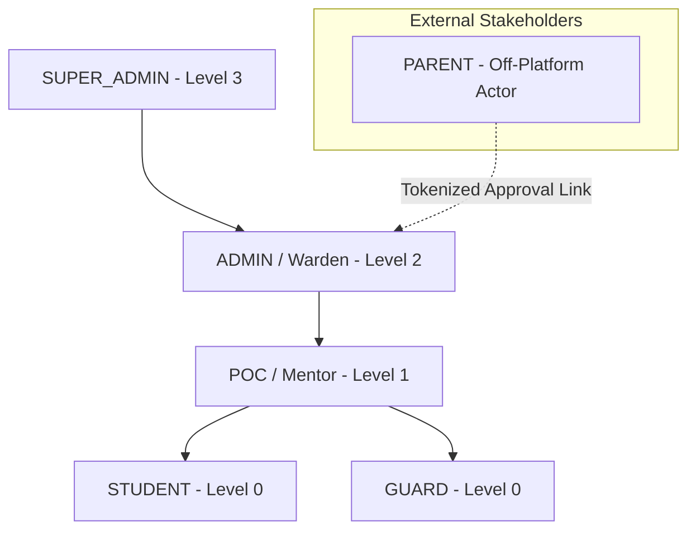

# 01 — System Overview

**Purpose:** Comprehensive overview of the SST Hostel Leave & Movement Management Platform.  
**Audience:** All engineers, architects, auditors, and technical leads.  
**Status:** **IMPLEMENTED** (Verified from repository inspection)

---

## 1. System Mission & Core Problem

The SST Hostel Leave System automates, audits, and enforces student leave workflows and physical movement tracking in an academic residential campus.

### Traditional Hostel Challenges Solved
1. **Paper-based leave slips**: Fragile, easy to forge, lack timestamp guarantees, and cause administrative bottlenecks.
2. **Disconnected approval vs. physical movement**: A student having permission to leave does not mean they actually exited, nor does it guarantee their return time is recorded.
3. **Parent communication delays**: Manual phone calls by wardens are slow and untraceable.
4. **Curfew and security enforcement**: Security guards at campus gates need instant, tamper-proof verification of whether a student has an active pass for that specific time window.

---

## 2. Core User Roles & Responsibilities

The system defines 5 authoritative roles in `src/lib/auth/roles.ts`, organized in a strict operational hierarchy:

| Role | Hierarchy Level | Primary Responsibilities | Interface & Access Method |
| :--- | :--- | :--- | :--- |
| **`STUDENT`** | Level 0 | Submit leave requests, upload medical/academic proofs, request extensions, view and display QR gate passes. | Student Web Portal (Clerk Authenticated) |
| **`GUARD`** | Level 0 | Scan student QR exit and return passes at campus gates, perform identity previews, log manual gate checkouts/returns. | Guard Scanner Interface (Clerk Authenticated) |
| **`POC`** (Point of Contact) | Level 1 | Faculty/department level mentors who review academic leaves and college late-stay permissions before warden review. | Approver Dashboard (Clerk Authenticated) |
| **`ADMIN`** (Hostel Warden) | Level 2 | Hostel wardens and residential staff who grant final approvals, verify uploaded documents, and track overdue students. | Administrative Dashboard (Clerk Authenticated, Scoped to Hostel) |
| **`SUPER_ADMIN`** | Level 3 | Global campus administrators who manage policies, workflow definitions, leave types, system configuration, and audits. | Super Admin Console (Unrestricted Scope) |
| **`PARENT`** | N/A (External) | Verify and approve student leave requests via one-time SMS/Email tokenized magic links. | Tokenized Web Link (No Login Account / No Clerk Session) |

---

## 3. Key Business Domains

The codebase is organized into bounded contexts (`src/db/schema/` and `src/services/`):

1. **Auth & Identity Domain (`auth`)**: User management, Clerk ID synchronization, role assignment, and multi-tenant resource scoping (Hostel, Department).
2. **Leave Domain (`leave`)**: Leave applications, dynamic JSON form validation, immutable leave type versioning, extension requests, and document attachments.
3. **Approval Domain (`workflow`)**: Configuration-driven multi-step approval chains (`workflow_definitions`, `workflow_steps`, `workflow_versions`), with auto-approval and parent delegation rules.
4. **Parent Domain (`parent`)**: High-entropy token generation, cryptographic SHA-256 storage, TTL enforcement, and unauthenticated decision processing.
5. **Movement & QR Domain (`movement`)**: AES-256-GCM encrypted QR token generation, cryptographic gate scans, real-time student location state machine, and scan audit logging.
6. **Policy Engine (`policy`)**: Configurable business rules evaluated prior to leave creation: maximum days, batch restrictions, curfews, and blocked academic periods.
7. **Notification & Outbox Domain (`outbox`, `notification`)**: Guaranteed at-least-once message delivery using a transactional outbox table, lease-based worker polling, and multi-channel providers (SES, Resend, Twilio SMS, Slack).
8. **Audit Domain (`audit`)**: Immutable chronological ledger tracking entity mutations, approver decisions, and gate scans with tier-based retention schedules.

---

## 4. Technology Stack Summary

* **Frontend Framework**: Next.js 16.2.11 App Router, React 19.2.4
* **Language & Typing**: TypeScript 5, strict mode enabled
* **Database & ORM**: PostgreSQL (hosted on Neon Serverless via `@neondatabase/serverless`), Drizzle ORM 0.45.2, Drizzle Kit 0.31.10
* **Authentication**: Clerk Authentication (`@clerk/nextjs` 6.39.3) for internal users; Cryptographic tokenized URLs for parents
* **Styling & UI**: Tailwind CSS 4, Radix UI primitives, shadcn/ui design system, Lucide icons
* **QR Processing**: `qrcode` 1.5.4 (generation), `@yudiel/react-qr-scanner` 2.6.0 (gate camera scan)
* **Messaging & Integrations**:
  * Email: AWS SES (`@aws-sdk/client-ses`), Resend SDK
  * Object Storage: AWS S3 (`@aws-sdk/client-s3`, presigned URLs)
  * Chat Alerts: Slack Web API (`@slack/web-api`)
  * SMS: Native HTTP SMS provider integration
* **Testing & Quality**: Vitest 4.1.8, React Testing Library, ESLint with `eslint-plugin-boundaries`

---

## 5. Architectural Golden Rules (Enforced by Constitution)

As mandated by `AGENTS.md` and verified in code:
1. **Flow is unidirectional**: `Route → DTO Validation → Service → Repository → Database`. Bypassing layers is forbidden and blocked by ESLint boundary checks.
2. **Leave Approval is NOT Movement**: A leave approval represents *permission*. A movement event represents *physical reality*. A student with an approved leave remains `IN_HOSTEL` until a guard scans their exit pass.
3. **Extensions are NOT New Leaves**: Leave extensions are tracked in `leave_extensions` linked to the original `leave_requests` record.
4. **Workflows are Configuration-Driven**: Approval chains are read from `workflow_definitions` and `workflow_steps`, never hardcoded in code.
5. **Immutable Historical Versioning**: Modifying a policy, workflow, or leave type does not alter existing leaves; leaves freeze their execution context via `leave_configuration_contexts`.
