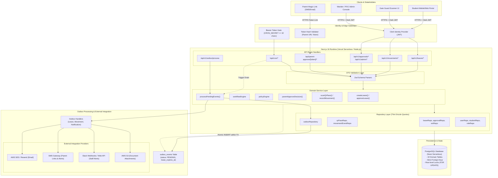

# 02 — High-Level Design (HLD) System Architecture

**Purpose:** Comprehensive architecture diagram and component topology for the SST Hostel Leave system.  
**Audience:** System architects, backend engineers, and technical leadership.  
**Status:** **IMPLEMENTED** (Verified from repository inspection)

---

## 1. System Topology & Architectural Flow

The SST Hostel Leave platform is structured as a cloud-native Next.js system backed by a serverless PostgreSQL database, integrating with Clerk for staff/student identity and external notification providers via a transactional outbox pattern.

---

## 2. Component Specifications

### 2.1 Next.js 16 Application Server
* **Responsibility**: Houses React Server Components, server actions, API route handlers, and domain logic.
* **Inputs & Outputs**: Receives JSON HTTP requests from browsers and webhook clients; returns structured standard envelopes:
  * Success: `{ success: true, data: T }`
  * Error: `{ success: false, error: { code: string, message: string } }`
* **Dependencies**: Node.js runtime, `@neondatabase/serverless`, `@clerk/nextjs`.
* **Failure Modes**: Cold starts during traffic spikes; unhandled server exceptions caught by global error boundaries.

### 2.2 PostgreSQL Database (Neon Serverless)
* **Responsibility**: System of record for all business entities, immutable configuration versions, gate audit events, and the transactional outbox queue.
* **Key Characteristics**:
  * Serializable / Read Committed transaction isolation.
  * Explicit pessimistic locking (`SELECT ... FOR UPDATE`) during leave creation, approval transitions, and gate scans to prevent concurrent duplicate states.
  * Check constraints enforce business invariants (e.g., `num_nonnulls(leaveRequestId, leaveExtensionId) = 1` in `leave_approvals`).

### 2.3 Identity & Access Management (Clerk)
* **Responsibility**: Handles student and staff authentication (passwords, SSO, email verification).
* **Identity Linking**: `src/lib/auth/get-current-user.ts` extracts the Clerk user ID, queries the local `users` table, and automatically links pre-provisioned DB accounts *only* if the Clerk email verification status is `verified` (preventing account takeover).

### 2.4 Transactional Outbox Worker
* **Responsibility**: Decouples database state updates from external API latency (AWS SES, Twilio, Slack).
* **Guarantees**:
  * At-least-once delivery guaranteed.
  * Lease-based claim loop: Worker claims up to 50 pending events with a 5-minute lease (`lease_expires_at`).
  * Exponential backoff and maximum retry budget (5 attempts) before moving to `DEAD_LETTER`.

---

## 3. Communication Boundaries

| Boundary | Protocol | Synchronous / Asynchronous | Timeout / Failure Policy |
| :--- | :--- | :--- | :--- |
| **Browser ↔ API** | HTTPS / REST | Synchronous | 15s Vercel Serverless timeout |
| **Parent ↔ Decision Route** | HTTPS / REST | Synchronous | Single token validation and status mutation |
| **App ↔ Neon Database** | Postgres Wire / WebSockets | Synchronous | Bound by active transaction scope |
| **App ↔ Outbox Table** | SQL `INSERT` | Synchronous (within business TX) | If DB commit fails, no event is ever emitted |
| **Outbox Worker ↔ External Providers** | HTTPS REST / SDK | Asynchronous | Retried with exponential backoff up to 5 times |
| **Vercel Cron ↔ API** | HTTPS / REST | Synchronous (Cron Trigger) | Secured by `Authorization: Bearer <CRON_SECRET>` |

---

## 4. Scalability & Architectural Tradeoffs

1. **Serverless Architecture**:
   * *Tradeoff*: Instant horizontal scaling with zero infrastructure maintenance, at the cost of short cold starts and strict execution time limits.
2. **Database-Backed Outbox vs. SQS/Kafka**:
   * *Tradeoff*: Using PostgreSQL as the outbox queue avoids running external message brokers (SQS was explicitly replaced by direct DB polling in `src/db/schema/outbox.ts`). At hostel scale (< 100,000 movements/year), PostgreSQL easily handles the queue with minimal operational overhead.
3. **Pessimistic Locking (`FOR UPDATE`)**:
   * *Tradeoff*: Serializes concurrent approvals and gate scans on the exact leave row. Prevents race conditions completely, but increases database transaction latency slightly during concurrent scans.
