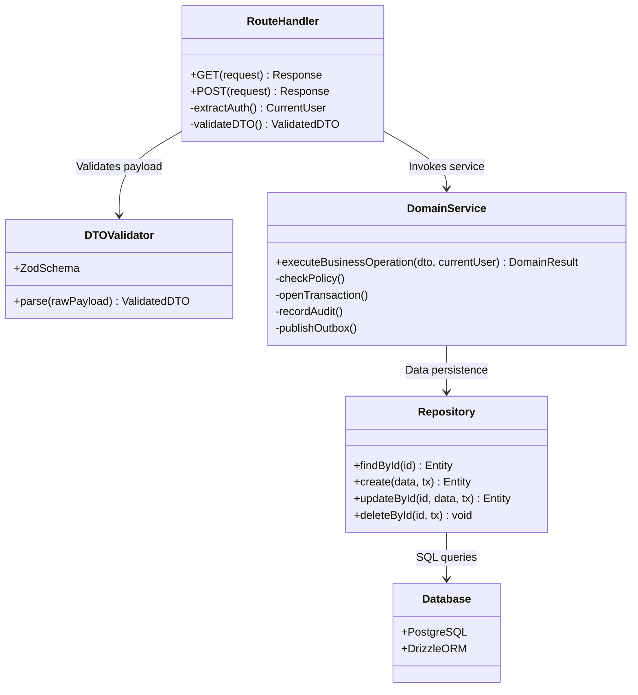
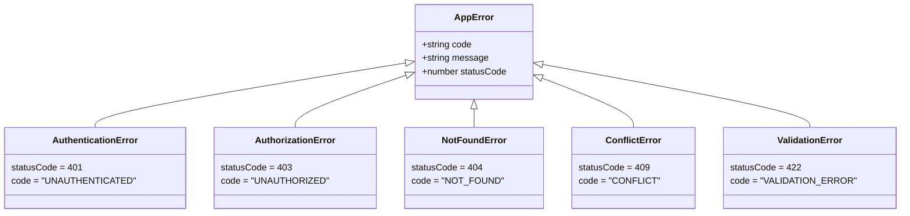

# 03 — Application Layer Architecture

**Purpose:** Detailed architectural specification of the mandatory 4-layer architecture, DTO validation, error handling, and API envelope contracts.  
**Audience:** Backend engineers, code reviewers, and software contributors.  
**Status:** **IMPLEMENTED** (Verified from repository inspection)

---

## 1. The Mandatory 4-Layer Architecture

The SST Hostel Leave system enforces a strict unidirectional layered architecture defined in `AGENTS.md` and enforced via ESLint boundary rules (`eslint-plugin-boundaries` in `package.json`):

```text
Route Handlers (/app/api/*)
       │
       ▼
DTO Validation (Zod Schemas in /dto/*)
       │
       ▼
Domain Services (/services/*)
       │
       ▼
Repositories (/db/repositories/*)
       │
       ▼
Database (PostgreSQL via Drizzle ORM)
```

### Prohibited Cross-Layer Violations
* `Route → Database`: Strictly forbidden. Routes must never call Drizzle or issue SQL.
* `Route → Repository`: Bypassing the service layer is disallowed because business validation, authorization checks, and audit trails live in services.
* `Repository → Service`: Repositories must remain thin CRUD data-access modules.
* `Service → UI`: Services must be UI-agnostic and return clean domain models or DTOs.



---

## 2. Layer Responsibilities & Contracts

### 2.1 Route Handlers (`src/app/api/v1/.../route.ts`)
* **Responsibilities**:
  1. Authenticate callers via `requireAuth()` (`src/lib/auth/require-auth.ts`) or `checkCronAuth()` (`src/lib/auth/cron-auth.ts`).
  2. Parse HTTP JSON request bodies or query parameters.
  3. Invoke Zod DTO schema validation.
  4. Call corresponding domain services.
  5. Format output using `ApiResponse.success(data, status)` or `ApiResponse.fromError(error)`.
* **Forbidden**: Direct SQL queries, policy evaluation, workflow logic, emailing, or direct DB mutations.

### 2.2 DTO Validation Layer (`src/dto/...`)
* **Responsibilities**:
  * Define explicit input contracts using Zod.
  * Enforce primitive constraints (e.g. date strings in ISO format, min/max length, UUID formatting, non-empty arrays).
  * Infer and export strongly typed TypeScript interfaces (e.g., `export type CreateLeaveDto = z.infer<typeof createLeaveSchema>`).

### 2.3 Domain Service Layer (`src/services/...`)
* **Responsibilities**:
  * Orchestrate domain business logic and state machine transitions.
  * Evaluate policies through `policyEngine`.
  * Manage database transaction boundaries (`db.transaction(async (tx) => { ... })`).
  * Acquire pessimistic row locks (`findByIdForUpdate`).
  * Emit audit entries (`auditService.record`).
  * Publish outbox records within active transactions (`outboxService.publish`).
* **Design Rule**: Services are functional or object-oriented singletons. They must throw domain errors when invariants are violated.

### 2.4 Repository Layer (`src/db/repositories/...`)
* **Responsibilities**:
  * Execute atomic queries against PostgreSQL via Drizzle ORM.
  * Accept optional transaction clients (`tx: DbClient`) to support compositional transactions.
  * Return Drizzle-inferred model types or custom projection rows.
* **Design Rule**: Repositories must remain thin. No notifications, no approvals, no QR generation, no business decisions inside repositories.

---

## 3. Standard API Response Contracts

All REST API endpoints implement the standardized `ApiResponse` helper defined in `src/lib/api/response.ts`.

### Success Response Envelope
```json
{
  "success": true,
  "data": {
    "id": "c1f7a30b-9999-4c2f-a18e-48618e47d101",
    "requestNumber": "LR-1738914000000",
    "status": "PENDING"
  }
}
```

### Failure Response Envelope
```json
{
  "success": false,
  "error": {
    "code": "VALIDATION_ERROR",
    "message": "Policy requires parent approval, but the configured workflow has no parent approval step"
  }
}
```

---

## 4. Domain Error Hierarchy

Errors thrown across the application extend standard domain error classes (`src/lib/errors/index.ts`):



* **`AuthenticationError` (401)**: Missing, malformed, or unverified Clerk identity.
* **`AuthorizationError` (403)**: Caller does not possess the required role (e.g., student attempting to call admin route) or falls outside the hostel scope.
* **`NotFoundError` (404)**: Entity with requested UUID does not exist or has been soft-deleted.
* **`ConflictError` (409)**: State machine violation (e.g., attempting to approve an expired leave, concurrent scan of already used pass).
* **`ValidationError` (422)**: Payload failed syntactic Zod validation or semantic schema rules.

---

## 5. Architectural Lint Rules & Code Style

The repository utilizes strict automated lint boundaries:
* **`eslint-plugin-boundaries`**: Disallows imports across unauthorized domain layers (e.g., preventing a route from importing Drizzle client directly).
* **Import Paths**: Absolute path aliases (`@/...`) are mandatory. Relative parent traversal (`../../..`) is banned.
* **Type Safety**: Explicit function return types are required on exported functions. `any` is forbidden; `unknown` or inferred types are used.
