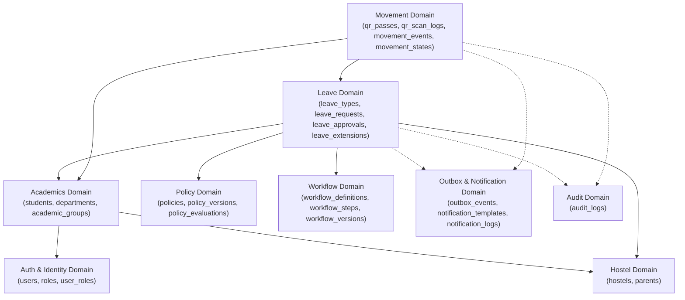
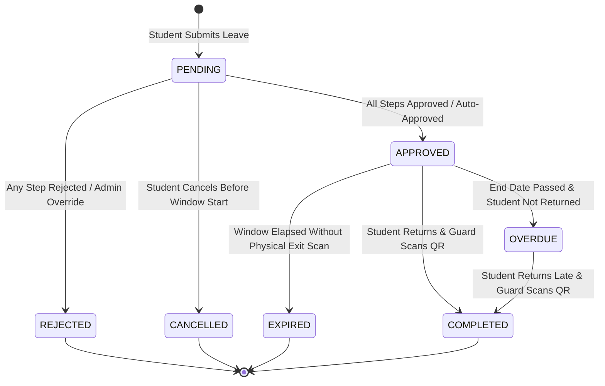
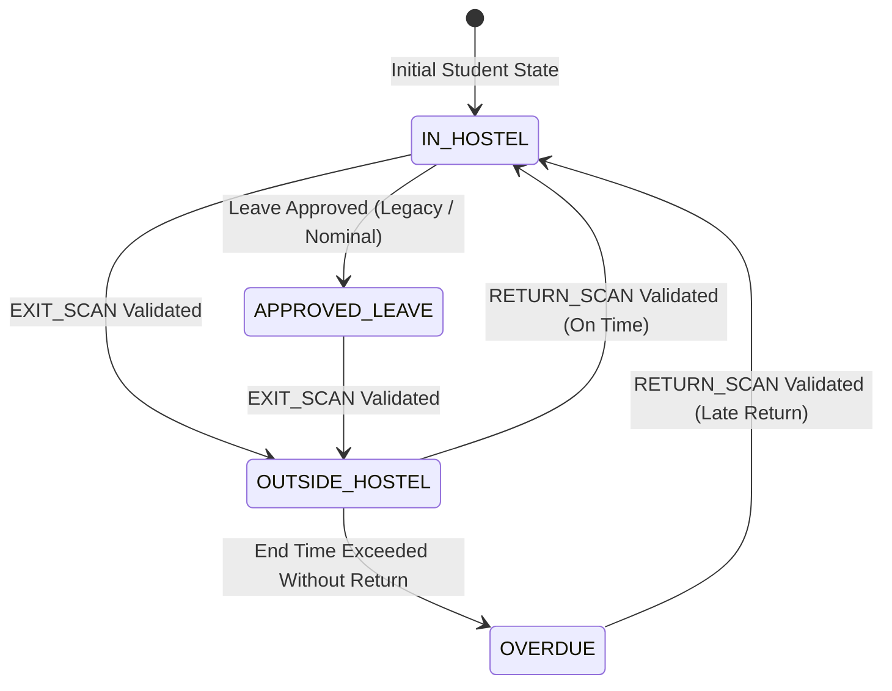
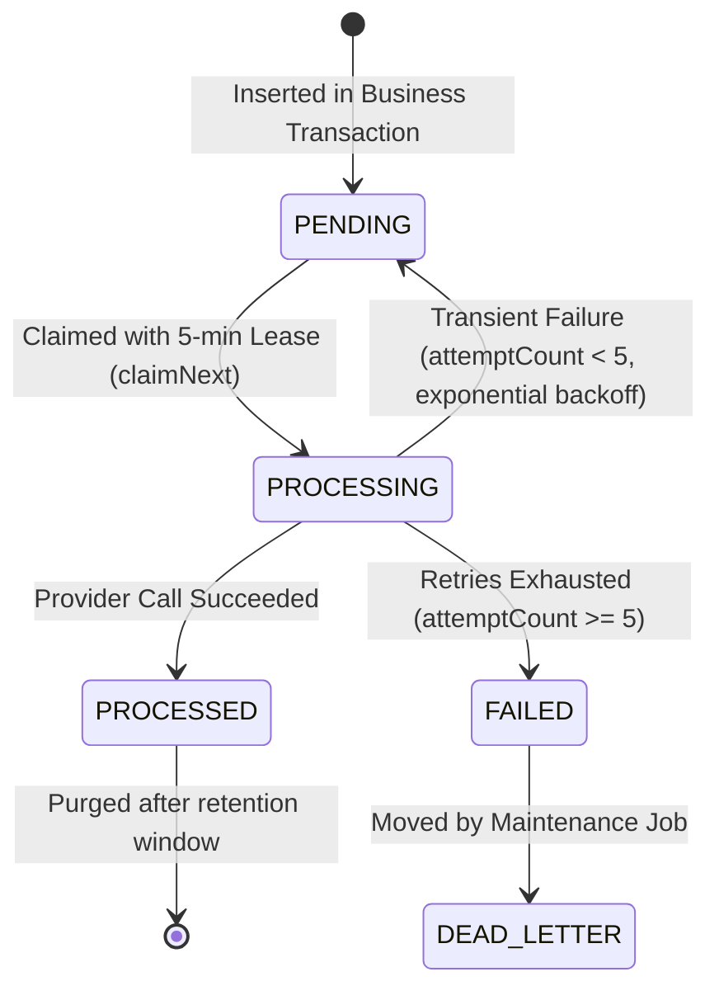

# 04 — Low-Level Design (LLD) Domain Design

**Purpose:** Low-level structural design, public interfaces, domain invariants, and state models across all core domains.  
**Audience:** Senior backend engineers, database developers, and technical reviewers.  
**Status:** **IMPLEMENTED** (Verified from repository inspection)

---

## 1. Domain Overview & Collaborators

The system contains 8 core domains. Below is the collaboration graph showing directional dependencies:

---

## 2. Leave Domain LLD

### 2.1 Public Interfaces & Services
* `createLeave(dto: CreateLeaveDto, currentUser: CurrentUser): Promise<LeaveRequest>` (`src/services/leave/create-leave.service.ts`)
* `approveLeave(leaveId: string, dto: ApproveLeaveDto, currentUser: CurrentUser): Promise<ApproveLeaveResult>` (`src/services/leave/approve-leave.service.ts`)
* `rejectLeave(leaveId: string, dto: RejectLeaveDto, currentUser: CurrentUser): Promise<void>` (`src/services/leave/reject-leave.service.ts`)
* `cancelLeave(leaveId: string, currentUser: CurrentUser): Promise<void>` (`src/services/leave/cancel-leave.service.ts`)
* `createExtension(leaveId: string, dto: CreateExtensionDto, currentUser: CurrentUser): Promise<LeaveExtension>` (`src/services/leave/create-extension.service.ts`)

### 2.2 Key Domain Invariants
1. **Student Exclusivity**: Only authenticated users mapped to active student records can create leaves.
2. **Overlap Prohibition**: A student cannot have overlapping approved or pending leave windows if the leave type uses QR gates (`assertNoConflictingOverlap`).
3. **Pessimistic State Protection**: Any mutation to a leave request must lock the target row via `SELECT ... FOR UPDATE` before evaluating state machine rules.
4. **Configuration Immutability**: Leaves link to `leave_configuration_contexts`, preserving the exact immutable versions of policies, workflow steps, and form schemas active at submission time.

### 2.3 Leave State Machine
The leave lifecycle is governed by `src/lib/workflows/leave-state-machine.ts`:

---

## 3. Movement & QR Domain LLD

### 3.1 Public Interfaces & Services
* `previewQrScan(token: string): Promise<QrScanPreview>` (`src/services/movement/scan-qr.service.ts`)
* `scanQrPass(input: ScanQrInput): Promise<ScanResult>` (`src/services/movement/scan-qr.service.ts`)
* `recordMovement(input: RecordMovementInput): Promise<MovementEvent>` (`src/services/movement/record-movement.service.ts`)
* `manualCheckout(studentId: string, reason: string, staffUser: CurrentUser): Promise<MovementEvent>` (`src/services/movement/manual-checkout.service.ts`)
* `manualReturn(studentId: string, reason: string, staffUser: CurrentUser): Promise<MovementEvent>` (`src/services/movement/manual-return.service.ts`)

### 3.2 Key Invariants
1. **Pass Window Usability**: An `ACTIVE` pass is only scannable when `validFrom <= now <= expiresAt`. Passes outside this temporal window fail closed.
2. **Guarded State Transition**: Gate scans atomically execute `markAsFirstScanned` (for exit) or `markAsClosed` (for return). If a concurrent request executes between read and write, the guarded transition returns `null` and rolls back.
3. **Location State Synchronization**: Every recorded movement event updates `students.currentLocationState` to reflect real-world physical location.

### 3.3 Movement State Machine
Governed by `movementStates` and `src/services/movement/movement-state-machine.ts`:

---

## 4. Policy Engine Domain LLD

### 4.1 Interface & Rule Categories
The policy engine (`src/services/policy/policy-engine.ts`) evaluates rules in strict order:

| Rule Category | Variant | Engine Action |
| :--- | :--- | :--- |
| **`LIMIT`** | `MAX_DAYS` | Compares `leaveDurationDays` against threshold; adds restriction if exceeded. |
| **`LIMIT`** | `MAX_EXTENSION_COUNT` | Compares total extensions against `leave_type.maxExtensionCount`. |
| **`ELIGIBILITY`** | `BATCH_RESTRICTION` | Checks `studentBatchYear` against blocked batch array. |
| **`ELIGIBILITY`** | `PARENT_APPROVAL_REQUIRED` | Adds to `requirements` array (does not fail; mandates parent step in workflow). |
| **`TIME_WINDOW`** | `CURFEW` | Compares `endAt` in **IST time** (Asia/Kolkata) against daily hostel curfew. |
| **`TIME_WINDOW`** | `BLOCKED_PERIOD` | Queries `operational_periods` table for overlaps with academic blackout dates. |
| **`FORM_VALIDATION`** | `FIELD_RESTRICTION` / `WITHIN_DAYS` | Validates custom dynamic form answers against regexes and time horizons. |

---

## 5. Outbox & Notification Domain LLD

### 5.1 Outbox Service Interface
* `publish(event: DomainEvent, tx?: DbClient): Promise<void>` (`src/services/outbox/outbox.service.ts`)
* `processPendingEvents(): Promise<{ processed: number, failed: number }>` (`src/services/outbox/outbox-worker.service.ts`)

### 5.2 Outbox Event Lifecycle

