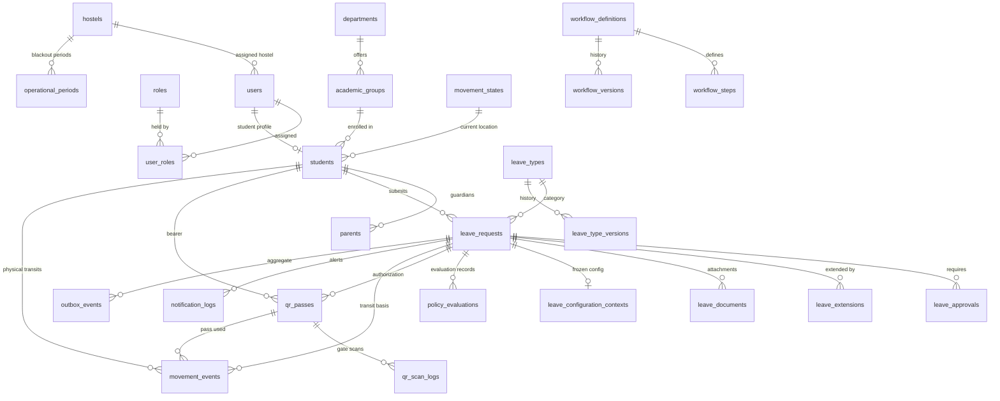

# 05 — Database Schema & Entity Relationship Diagram (ERD)

**Purpose:** Complete relational database reference, ER diagrams, foreign keys, constraints, and index inventory.  
**Audience:** Database administrators, backend architects, and performance engineers.  
**Status:** **IMPLEMENTED** (Verified directly from `src/db/schema/*.ts`)

---

## 1. Domain Entity Relationship Diagram

Because the system comprises 32 interrelated tables, the ER model is split into four focused domain sub-diagrams followed by an architectural overview.

### 1.1 Core Domain Relationships (Leave, Approval, Movement, Identity)

---

## 2. Table Catalog & Constraint Specifications

### 2.1 Identity & Access Domain

#### `users` (`src/db/schema/auth.ts`)
* **Primary Key**: `id` (UUID, defaultRandom)
* **Columns**:
  * `clerk_id`: TEXT, UNIQUE, NULLABLE (linked upon authenticated sign-in)
  * `hostel_id`: UUID, FK → `hostels.id` (`onDelete: set null`)
  * `full_name`: TEXT, NOT NULL
  * `email`: TEXT, UNIQUE, NULLABLE
  * `phone`: TEXT, UNIQUE, NULLABLE
  * `slack_id`: TEXT, NULLABLE (Slack member `U...` or group `S...` ID)
  * `gender`: `gender` ENUM ('MALE', 'FEMALE', 'OTHER')
  * `is_active`: BOOLEAN, NOT NULL, DEFAULT true
  * `last_login_at`: TIMESTAMP WITH TIME ZONE
  * `created_at`, `updated_at`, `deleted_at`: TIMESTAMPS
* **Indexes**: `users_hostel_id_idx` (`hostel_id`)

#### `roles` (`src/db/schema/auth.ts`)
* **Primary Key**: `id` (UUID)
* **Columns**: `code` (TEXT, UNIQUE, NOT NULL), `name` (TEXT, NOT NULL), `metadata` (JSONB)
* **Predefined Codes**: `SUPER_ADMIN`, `ADMIN`, `POC`, `STUDENT`, `GUARD`

#### `user_roles` (`src/db/schema/auth.ts`)
* **Primary Key**: `id` (UUID)
* **Columns**:
  * `user_id`: UUID, NOT NULL, FK → `users.id` (`onDelete: cascade`)
  * `role_id`: UUID, NOT NULL, FK → `roles.id` (`onDelete: cascade`)
  * `scope_type`: TEXT, NULLABLE (e.g. `'HOSTEL'`, `'DEPARTMENT'`)
  * `scope_id`: UUID, NULLABLE (Entity ID for scoping)
  * `assigned_by`: UUID, FK → `users.id`
  * `assigned_at`: TIMESTAMP WITH TIME ZONE, NOT NULL
* **Constraints**:
  * `user_roles_user_role_scope_unq`: UNIQUE INDEX on `(user_id, role_id, scope_type, scope_id)`
  * `user_roles_role_id_idx`: INDEX on `(role_id)`

---

### 2.2 Academics & Hostel Domain

#### `students` (`src/db/schema/academics.ts`)
* **Primary Key**: `id` (UUID)
* **Columns**:
  * `user_id`: UUID, NOT NULL, UNIQUE, FK → `users.id` (`onDelete: cascade`)
  * `academic_group_id`: UUID, NOT NULL, FK → `academic_groups.id` (`onDelete: restrict`)
  * `room_number`: TEXT
  * `roll_number`: TEXT, NOT NULL, UNIQUE
  * `current_location_state`: TEXT, NOT NULL, FK → `movement_states.code` (`onDelete: restrict`)
* **Indexes**: `student_user_id_idx`, `student_academic_group_id_idx`, `students_cur_loc_state_idx`

#### `hostels` (`src/db/schema/hostel.ts`)
* **Primary Key**: `id` (UUID)
* **Columns**: `name`, `code` (UNIQUE), `capacity`, `curfew_start_time`, `curfew_end_time`, `slack_channel_id`, `slack_admin_group_id`, `is_active`

#### `parents` (`src/db/schema/hostel.ts`)
* **Primary Key**: `id` (UUID)
* **Columns**: `student_id` (FK → `students.id`), `name`, `phone`, `email`, `relationship`, `is_primary`
* **Constraints**: `parent_student_phone_unq`: UNIQUE on `(student_id, phone)`

---

### 2.3 Leave & Workflow Domain

#### `leave_requests` (`src/db/schema/leave.ts`)
* **Primary Key**: `id` (UUID)
* **Columns**:
  * `request_number`: TEXT, NOT NULL, UNIQUE (Format: `LR-${Date.now()}`)
  * `student_id`: UUID, NOT NULL, FK → `students.id` (`onDelete: cascade`)
  * `leave_type_id`: UUID, NOT NULL, FK → `leave_types.id` (`onDelete: restrict`)
  * `reason`: TEXT, NOT NULL
  * `status`: `leave_status` ENUM ('PENDING', 'APPROVED', 'REJECTED', 'CANCELLED', 'EXPIRED', 'OVERDUE', 'COMPLETED')
  * `current_step_key`: TEXT, NULLABLE
  * `current_step_order`: INTEGER, NULLABLE
  * `policy_result`: JSONB
  * `start_at`: TIMESTAMP WITH TIME ZONE, NOT NULL
  * `end_at`: TIMESTAMP WITH TIME ZONE, NOT NULL
  * `actual_return_at`: TIMESTAMP WITH TIME ZONE, NULLABLE
  * `submitted_form`: JSONB, NOT NULL
  * `submitted_at`, `approved_at`, `rejectedAt`, `cancelledAt`, `expiredAt`, `completedAt`
* **Indexes**:
  * `leave_requests_student_id_idx` (`student_id`)
  * `leave_requests_status_idx` (`status`)
  * `lr_student_dates_idx` (`student_id`, `start_at`, `end_at`)
  * `lr_status_endat_return_idx` (`status`, `end_at`, `actual_return_at`)
  * `lr_status_created_idx` (`status`, `created_at`)

#### `leave_approvals` (`src/db/schema/leave.ts`)
* **Primary Key**: `id` (UUID)
* **Columns**:
  * `leave_request_id`: UUID, FK → `leave_requests.id` (`onDelete: cascade`)
  * `leave_extension_id`: UUID, FK → `leave_extensions.id` (`onDelete: cascade`)
  * `step_key`: TEXT, NOT NULL
  * `step_order`: INTEGER, NOT NULL
  * `approver_role_id`: UUID, FK → `roles.id`
  * `assigned_approver_user_id`: UUID, FK → `users.id`, nullable assigned reviewer
  * `acted_by_user_id`: UUID, FK → `users.id`, nullable user who recorded the decision
  * `approver_parent_id`: UUID, FK → `parents.id`
  * `decision`: `leave_approval_decision` ENUM ('PENDING', 'APPROVED', 'REJECTED', 'AUTO_APPROVED', 'CANCELLED')
  * `approval_source`: `approval_source` ENUM ('WEB', 'SMS', 'MANUAL', 'SYSTEM', 'PORTAL', 'SMS_REPLY', 'EMAIL_LINK')
  * `parent_approval_token`: TEXT, UNIQUE, NULLABLE (Stores SHA-256 hash of token)
  * `parent_approval_expires_at`: TIMESTAMP WITH TIME ZONE
  * `acted_at`: TIMESTAMP WITH TIME ZONE
* **Constraints**:
  * **Check Constraint**: `leave_approval_target_chk`: `num_nonnulls(leaveRequestId, leaveExtensionId) = 1`
  * **Composite Indexes**: `la_request_decision_step_idx` on `(leave_request_id, decision, step_order)`

#### `leave_configuration_contexts` (`src/db/schema/leave.ts`)
* **Primary Key**: `id` (UUID)
* **Columns**:
  * `leave_request_id`: UUID, NOT NULL, UNIQUE, FK → `leave_requests.id` (`onDelete: cascade`)
  * `leave_type_version_id`: UUID, NOT NULL, FK → `leave_type_versions.id` (`onDelete: restrict`)
  * `workflow_version_id`: UUID, NOT NULL, FK → `workflow_versions.id` (`onDelete: restrict`)
* **Purpose**: Freezes the historical configuration snapshot under which the leave was created.

---

### 2.4 Movement & Gate Scanning Domain

#### `qr_passes` (`src/db/schema/movement.ts`)
* **Primary Key**: `id` (UUID)
* **Columns**:
  * `leave_request_id`: UUID, NOT NULL, FK → `leave_requests.id` (`onDelete: cascade`)
  * `student_id`: UUID, NOT NULL, FK → `students.id` (`onDelete: cascade`)
  * `qr_type`: `qr_type` ENUM ('LEAVE_EXIT', 'LEAVE_RETURN')
  * `token_hash`: TEXT, NOT NULL, UNIQUE (SHA-256 hash used for gate scan lookups)
  * `token_enc`: TEXT, NULLABLE (AES-256-GCM ciphertext envelope for QR image rendering)
  * `status`: `qr_status` ENUM ('ACTIVE', 'USED', 'EXPIRED', 'INVALIDATED')
  * `valid_from`: TIMESTAMP WITH TIME ZONE (Leave start time)
  * `expires_at`: TIMESTAMP WITH TIME ZONE (Leave end time + return grace period)
  * `first_scan_at`: TIMESTAMP WITH TIME ZONE (Exit scan timestamp)
  * `closed_at`: TIMESTAMP WITH TIME ZONE (Return scan timestamp)
* **Constraints**:
  * `qr_pass_leave_request_qr_type_unq`: UNIQUE on `(leave_request_id, qr_type)`

#### `movement_events` (`src/db/schema/movement.ts`)
* **Primary Key**: `id` (UUID)
* **Columns**:
  * `student_id`: UUID, NOT NULL, FK → `students.id`
  * `leave_request_id`: UUID, FK → `leave_requests.id`
  * `qr_pass_id`: UUID, FK → `qr_passes.id`
  * `event_type`: `movement_event` ENUM ('LEAVE_APPROVED', 'EXIT_HOSTEL', 'ENTER_HOSTEL', 'AUTO_OVERDUE', 'MANUAL_RETURN', 'MANUAL_CHECKOUT', 'SECURITY_OVERRIDE', 'QR_INVALIDATED')
  * `from_state`: TEXT, FK → `movement_states.code`
  * `to_state`: TEXT, FK → `movement_states.code`
  * `movement_method`: `movement_method` ENUM ('QR', 'MANUAL', 'SYSTEM')
  * `is_manual_override`: BOOLEAN, DEFAULT false
  * `recorded_by`: UUID, FK → `users.id`
  * `occurred_at`: TIMESTAMP WITH TIME ZONE, NOT NULL
* **Indexes**: `movement_events_student_id_idx`, `me_student_occurred_idx`, `me_request_occurred_idx`

---

### 2.5 Outbox & Audit Domain

#### `outbox_events` (`src/db/schema/outbox.ts`)
* **Primary Key**: `id` (UUID)
* **Columns**:
  * `event_type`: TEXT, NOT NULL
  * `aggregate_type`: TEXT, NOT NULL (e.g. `'LEAVE_REQUEST'`, `'QR_PASS'`)
  * `aggregate_id`: UUID, NOT NULL
  * `payload`: JSONB, NOT NULL
  * `idempotency_key`: TEXT, NULLABLE, UNIQUE
  * `status`: `outbox_status` ENUM ('PENDING', 'PROCESSING', 'PROCESSED', 'FAILED', 'DEAD_LETTER')
  * `attempt_count`: INTEGER, DEFAULT 0
  * `last_error`: TEXT
  * `next_attempt_at`: TIMESTAMP WITH TIME ZONE (Enables backoff without polling all pending rows)
  * `lease_expires_at`: TIMESTAMP WITH TIME ZONE (Worker crash lock timeout)
  * `claimed_at`, `processed_at`: TIMESTAMP WITH TIME ZONE
* **Indexes**:
  * `outbox_events_status_idx` (`status`)
  * `oe_status_next_attempt_idx` (`status`, `next_attempt_at`)
  * `outbox_events_idempotency_key_unique_idx`: UNIQUE INDEX on `(idempotency_key)`

#### `audit_logs` (`src/db/schema/audit.ts`)
* **Primary Key**: `id` (UUID)
* **Columns**:
  * `actor_user_id`: UUID, FK → `users.id` (`onDelete: set null`)
  * `entity_type`: `audit_entity_type` ENUM
  * `entity_id`: UUID, NOT NULL
  * `action`: `audit_action` ENUM
  * `retention_class`: TEXT, DEFAULT `'STATE_TRANSITION'` (`'CONFIG_MUTATION'`, `'STATE_TRANSITION'`, `'USER_ACTION'`)
  * `metadata`: JSONB
  * `expires_at`: TIMESTAMP WITH TIME ZONE (NULL = keep forever)
* **Indexes**: `audit_entity_lookup_idx` on `(entity_type, entity_id)`, `audit_expires_at_idx`
