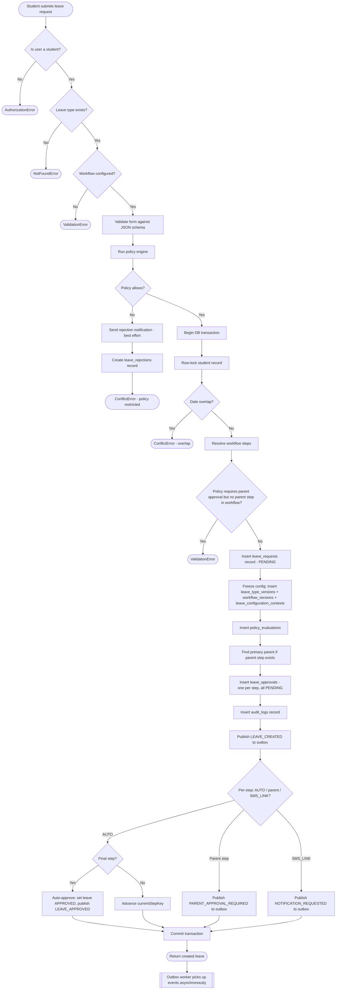
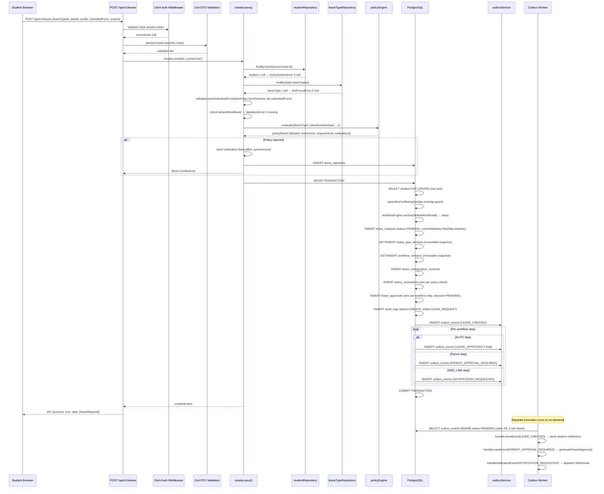

# 07 — Leave Creation: End-to-End

**Purpose:** Complete engineering reference for the leave creation flow.  
**Audience:** Backend engineers, QA, and technical architects.

---

## A. Business-Level Flowchart

---

## B. Technical Sequence Diagram

---

## C. File-by-File Execution Trace

| Source File | Function | Inputs | Validates | Calls | Reads / Writes | Returns | Errors |
|---|---|---|---|---|---|---|---|
| `src/app/api/v1/leaves/route.ts` | `POST` handler | Raw HTTP request | Clerk session | `createLeave()` | — | `201 {success, data}` | 401, 403, 409, 500 |
| `src/dto/leave/create-leave.dto.ts` | `CreateLeaveDto` (Zod) | Request body | leaveTypeId, startAt, endAt, submittedForm, reason | — | — | typed DTO | ZodError → 400 |
| `src/services/leave/create-leave.service.ts` | `createLeave()` | `CreateLeaveDto`, `{id}` | Student existence, leave type existence, workflow config | Policy engine, overlap guard, workflow engine, repositories, outbox | R: students, leave_types, users, parents, workflow_definitions, workflow_steps W: leave_requests, leave_configuration_contexts, policy_evaluations, leave_approvals, audit_logs, outbox_events | `LeaveRequest` | `AuthorizationError`, `NotFoundError`, `ValidationError`, `ConflictError` |
| `src/services/leave/validate-leave-form.service.ts` | `validateLeaveSubmittedForm()` | `formSchema`, `submittedForm` | JSON schema conformance | — | — | `Record<string, unknown>` | `ValidationError` |
| `src/services/policy/policy-engine.ts` | `evaluate()` | Policy context | All active policy rules | `policyRepository.findActive()`, per-policy evaluators | R: policies, policy_versions | `PolicyResult {allowed, restrictions, requirements, checks, evaluations}` | — |
| `src/services/leave/overlap-guard.service.ts` | `assertNoConflictingOverlap()` | studentId, dates, qrMode, leaveTypeId, tx | Date overlap with existing leaves | `leaveRepository.findOverlapping()` | R: leave_requests (inside tx) | `void` | `ConflictError` |
| `src/services/workflow/workflow-engine.ts` | `resolve()` | `workflowId`, tx | Workflow existence | `workflowDefinitionRepository.findById()`, `workflowStepRepository.findByWorkflowId()` | R: workflow_definitions, workflow_steps (inside tx) | `{definition, steps}` | `NotFoundError` |
| `src/services/leave/leave-type-version.service.ts` | `getLatestVersion()` | `leaveTypeId`, tx | — | `leaveTypeVersionRepository.findLatest()` | R: leave_type_versions (inside tx) | `LeaveTypeVersion` | `NotFoundError` |
| `src/services/workflow/workflow-version.service.ts` | `getLatestVersion()` | `workflowId`, tx | — | `workflowVersionRepository.findLatest()` | R: workflow_versions (inside tx) | `WorkflowVersion` | `NotFoundError` |
| `src/db/repositories/leave/leave.repository.ts` | `create()` | leave fields, tx | — | Drizzle insert | W: leave_requests | `LeaveRequest` | DB error |
| `src/db/repositories/leave/leave-configuration-context.repository.ts` | `create()` | context fields, tx | — | Drizzle insert | W: leave_configuration_contexts | `LeaveConfigurationContext` | DB error |
| `src/db/repositories/policy/policy-evaluation.repository.ts` | `createMany()` | evaluations[], tx | — | Drizzle insert | W: policy_evaluations | `PolicyEvaluation[]` | DB error |
| `src/db/repositories/leave/leave-approval.repository.ts` | `createMany()` | approvals[], tx | — | Drizzle insert | W: leave_approvals | `LeaveApproval[]` | DB error |
| `src/services/audit/audit.service.ts` | `record()` | action, entity, id, userId, meta, tx | — | `auditRepository.create()` | W: audit_logs (inside tx) | `void` | DB error |
| `src/services/outbox/outbox.service.ts` | `publish()` | event payload, tx | — | `outboxRepository.create()` | W: outbox_events (inside tx) | `void` | DB error |

---

## D. Database Timeline

**State of key tables before and after a successful leave creation (single-step workflow, parent approval required):**

### Before (initial state)

| Table | Relevant rows |
|---|---|
| `students` | 1 row, `currentLocationState = IN_HOSTEL` |
| `leave_types` | 1 row, `defaultWorkflowId` set |
| `workflow_definitions` | 1 row |
| `workflow_steps` | 2 rows: stepOrder 1 = PARENT_APPROVAL, stepOrder 2 = ADMIN_APPROVAL |
| `leave_requests` | 0 rows for student |
| `leave_approvals` | 0 rows |
| `outbox_events` | 0 pending rows for this student |

### After (transaction committed)

| Table | New / Updated rows |
|---|---|
| `leave_requests` | +1 row: `requestNumber=LR-<timestamp>`, `status=PENDING`, `currentStepKey=PARENT_APPROVAL`, `currentStepOrder=1` |
| `leave_configuration_contexts` | +1 row linking `leaveRequestId → leaveTypeVersionId → workflowVersionId` |
| `policy_evaluations` | +N rows (one per active policy check, `passed=true`) |
| `leave_approvals` | +2 rows: stepOrder 1 `decision=PENDING approverParentId=<id>`, stepOrder 2 `decision=PENDING approverRoleId=ADMIN_ROLE_ID` |
| `audit_logs` | +1 row: `action=CREATE`, `entityType=LEAVE_REQUEST`, `entityId=<leave.id>` |
| `outbox_events` | +2 rows: `LEAVE_CREATED` (status=PENDING), `PARENT_APPROVAL_REQUIRED` (status=PENDING) |

### After outbox worker runs

| Table | Change |
|---|---|
| `outbox_events` | Both rows: `status=PROCESSED`, `processedAt=<now>` |
| `notification_logs` | +1 row per channel dispatched for the LEAVE_CREATED notification |
| `leave_approvals` | Row for PARENT_APPROVAL step: `parentApprovalToken=<sha256_hash>`, `parentApprovalExpiresAt=<+48h>` |
| `outbox_events` | +1 row: `NOTIFICATION_REQUESTED` (for parent SMS link), then processed |

---

## E. Success and Failure Paths

### ✅ Success Path

1. All validations pass → transaction commits atomically.
2. Outbox worker (async) delivers notifications and generates parent approval token.
3. Student sees leave in `PENDING` state with `currentStepKey = first workflow step`.

### ❌ Failure Scenarios

| Scenario | Where it fails | Error type | HTTP status | DB state |
|---|---|---|---|---|
| User is not a student | `studentRepository.findByUserId()` returns null | `AuthorizationError` | 403 | No writes |
| `leaveTypeId` does not exist | `leaveTypeRepository.findById()` returns null | `NotFoundError` | 404 | No writes |
| Leave type has no configured workflow | `defaultWorkflowId` is null | `ValidationError` | 422 | No writes |
| Form data fails JSON schema | `validateLeaveSubmittedForm()` | `ValidationError` | 422 | No writes |
| Policy engine blocks request | `policyResult.allowed === false` | `ConflictError` | 409 | `leave_rejections` +1 row; notification attempted (best-effort) |
| Date overlap with existing leave | `assertNoConflictingOverlap()` inside tx | `ConflictError` | 409 | Transaction rolled back |
| Policy requires parent approval but workflow has no parent step | Workflow step check inside tx | `ValidationError` | 422 | Transaction rolled back |
| DB failure mid-transaction | Any repository inside tx | DB error | 500 | Transaction rolled back atomically — no partial writes |
| Outbox worker fails to deliver notification | Handler throws | Worker retries up to MAX_RETRIES=5 | — | Leave created successfully; notification delayed or eventually fails to `DEAD_LETTER` |

> [!IMPORTANT]
> **VERIFIED** (from `create-leave.service.ts`): The policy rejection notification is sent **synchronously before the `ConflictError` is thrown**, not via the outbox. This is intentional — the comment in the code calls it "best-effort" and explicitly notes that a provider outage must not fail the rejection itself.

---

## F. Non-Technical Explanation

**Ravi, a student, wants to go home this weekend.**

1. Ravi opens the leave portal and fills in a form: dates, reason, and any required fields (e.g. destination, parent contact).
2. He clicks Submit. The system checks: Is he allowed? Does his batch, hostel, and leave type allow this request under the current rules?
3. If the rules say No (e.g. exam period), Ravi gets an email explaining why, and his request is recorded as rejected for audit purposes.
4. If the rules say Yes, the system creates the leave request and notifies the first approver. If Ravi's leave type requires parent approval first, the system automatically sends Ravi's parent an SMS with a one-click approval link.
5. Ravi can see his request in the portal as "Pending" while approvals happen.

---

## G. Technical Explanation

**HTTP request to DB commit:**

1. `POST /api/v1/leaves` arrives with a Clerk session JWT.
2. Clerk middleware validates the JWT and extracts `currentUser.id`.
3. Zod parses and validates the request body against `CreateLeaveDto`.
4. `createLeave(dto, currentUser)` is called:
   - `studentRepository.findByUserId(currentUser.id)` — row read, throws `AuthorizationError` if null.
   - `leaveTypeRepository.findById(dto.leaveTypeId)` — row read, throws `NotFoundError` if null.
   - `validateLeaveSubmittedForm(leaveType.formSchema, dto.submittedForm)` — pure in-memory JSON schema validation.
   - `policyEngine.evaluate(...)` — reads active policies from DB, evaluates each; if `allowed=false`, writes one `leave_rejections` row and throws `ConflictError`.
   - `requestNumber = LR-${Date.now()}` — millisecond timestamp string, **not a UUID**.
5. `db.transaction(async (tx) => {...})` begins:
   - `studentRepository.findByIdForUpdate(student.id, tx)` — `SELECT ... FOR UPDATE`, serializes concurrent submissions from the same student.
   - `assertNoConflictingOverlap(...)` — checks `leave_requests` for overlapping date ranges inside the transaction snapshot.
   - `workflowEngine.resolve(defaultWorkflowId, tx)` — reads `workflow_definitions` + `workflow_steps`.
   - Validates that workflow satisfies policy requirements (parent approval step present if required).
   - Inserts: `leave_requests` → `leave_configuration_contexts` → `policy_evaluations` → `leave_approvals` → `audit_logs` → `outbox_events`.
   - All inserts are inside the same transaction. **If any single insert fails, all writes roll back.**
6. Transaction commits. The HTTP response returns `201` with the created leave.
7. A separate outbox worker invocation (triggered by cron at `POST /api/v1/outbox/process` or the `/api/cron/maintenance` route) claims the pending `outbox_events` rows and dispatches notifications asynchronously.
