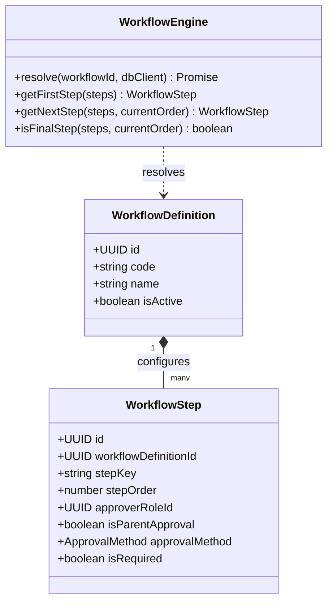
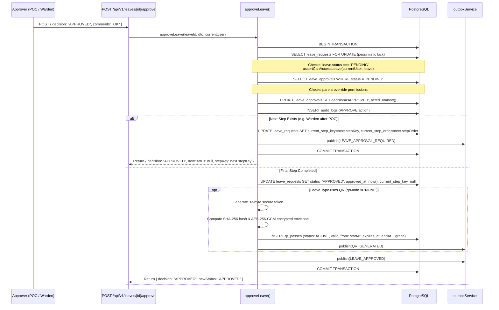

# 08 — Approval Workflow Engine

**Purpose:** Complete design and execution trace of the configuration-driven approval workflow subsystem.  
**Audience:** Backend engineers, workflow architects, and system integrators.  
**Status:** **IMPLEMENTED** (Verified from `src/services/workflow/workflow-engine.ts` and `src/services/leave/approve-leave.service.ts`)

---

## 1. Workflow Architecture & Philosophy

In accordance with `AGENTS.md`, approval workflows are **strictly configuration-driven**. Approval chains are never hardcoded (e.g., `Parent → Warden` or `POC → Warden` are read from the database).

### Database Model
* **`workflow_definitions`**: High-level workflow container (`HOSTEL_STANDARD`, `ACADEMIC_EVENT`, `LATE_STAY`).
* **`workflow_steps`**: Ordered approval requirements:
  * `step_order`: Execution sequence integer (1, 2, 3...).
  * `step_key`: Semantic identifier (e.g., `PARENT_APPROVAL`, `POC_APPROVAL`, `WARDEN_APPROVAL`).
  * `approver_role_id`: FK to `roles.id`.
  * `is_parent_approval`: Boolean flag indicating parent verification.
  * `approval_method`: Method enum (`AUTO`, `SMS_LINK`, `PORTAL`).
* **`workflow_versions`**: Immutable JSON snapshot of steps created whenever a definition changes, ensuring active leaves are insulated from workflow mutations.

---

## 2. Multi-Step Approval Execution Flow

---

## 3. Concurrency Protection & Pessimistic Locks

### The Double-Approval Race Condition
If two wardens simultaneously view and click "Approve" on the same leave request:
1. Both requests invoke `approveLeave()`.
2. Both transactions attempt `leaveRepository.findByIdForUpdate(leaveId, tx)`:
   * **Request A** acquires the exclusive row lock.
   * **Request B** is blocked by PostgreSQL until Request A commits or rolls back.
3. Request A updates the pending step and advances the workflow.
4. When Request A commits, Request B awakens:
   * Request B re-reads the leave row inside its transaction.
   * If Request A was the final step, `leaveInTx.status` is now `APPROVED`.
   * The invariant check `if (leaveInTx.status !== LEAVE_REQUEST_STATUS.PENDING)` immediately triggers a `ConflictError("Leave is not in a state that can be approved")`.
   * Request B rolls back safely with zero duplicate outbox events or corrupt approvals.

---

## 4. Special Leave Types & Parent Overrides

### 4.1 Special Leave Verification
* For leaves where `(leaveType.uiConfig as any)?.isSpecial === true` (e.g. Medical or Extended Academic):
* Approvers **must** pass `"documentsVerified": true` in `ApproveLeaveDto`.
* Attempting to approve without document verification throws `ValidationError("Documents must be verified before approving a special leave")`.

### 4.2 Parent Override Mechanism (`checkParentOverride`)
* If a leave is stalled waiting for a parent decision (`stepKey === 'PARENT_APPROVAL'`), an `ADMIN` or `SUPER_ADMIN` can override the step.
* If `confirmParentOverride` is false, the service returns `{ requiresConfirmation: true, warning: "Overriding parent approval requires confirmation" }`.
* When confirmed, the approval record logs `metadata: { isParentOverride: true }` in the audit log for regulatory compliance.
