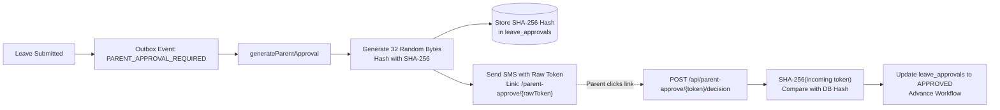
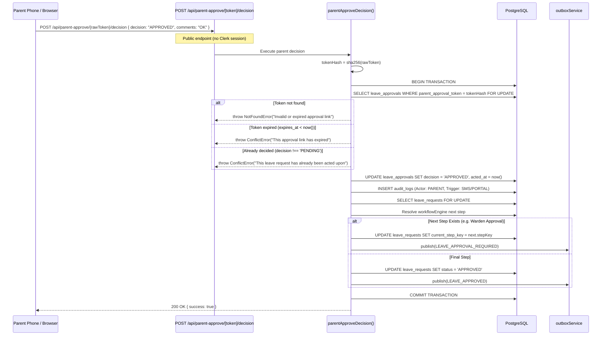

# 09 — Parent Approval Subsystem

**Purpose:** Comprehensive technical guide to parent authentication, high-entropy token generation, cryptographic storage, expiry handling, and decision processing.  
**Audience:** Security engineers, backend developers, and compliance reviewers.  
**Status:** **IMPLEMENTED** (Verified from `src/services/parent/*` and `src/app/api/parent-approve/[token]/decision/route.ts`)

---

## 1. Architectural Philosophy: Why No Parent Login?

As documented in `AGENTS.md`:
* Parents do **not** have user accounts, passwords, or Clerk sessions.
* Requiring parents to register, download apps, or manage credentials leads to abandoned leave requests and excessive warden support tickets.
* Instead, parent decisions authenticate via **one-time cryptographically secure magic links** delivered over verified SMS or email.



---

## 2. Token Generation & Storage Architecture

### 2.1 Cryptographic Token Minting
Implemented in `src/services/parent/generate-parent-approval.service.ts`:
```ts
// 1. Generate 32 bytes of cryptographically secure random entropy (256 bits)
const rawBytes = new Uint8Array(32);
crypto.getRandomValues(rawBytes);
const rawToken = toHex(rawBytes); // 64 hex characters

// 2. Hash the raw token before storing in database
const tokenHash = await sha256(rawToken);

// 3. Compute expiration time
const expiresAt = new Date();
expiresAt.setHours(expiresAt.getHours() + PARENT_APPROVAL_TOKEN_EXPIRY_HOURS); // Default: 48 hours
```

### 2.2 Security Invariant: No Plaintext Storage
* The database **never** stores `rawToken`.
* Only `tokenHash` (SHA-256) is persisted in `leave_approvals.parent_approval_token`.
* If the database is compromised, an attacker cannot forge or click parent approval links because SHA-256 is a one-way collision-resistant hash.

---

## 3. Decision Processing Sequence



---

## 4. Replay & Abuse Protections

1. **Single-Use Guarantee**: Once `decision` transitions from `PENDING` to `APPROVED` or `REJECTED`, any subsequent click with the same token is rejected with `409 ConflictError("This leave request has already been acted upon")`.
2. **Token TTL Expiration**: `parent_approval_expires_at` is checked on every query. Expired tokens cannot execute decisions.
3. **Pessimistic Locking**: Concurrent requests with the same token lock the row via `FOR UPDATE`, preventing double-execution.
4. **Audit Attribution**: Audit records record `actorType: ACTOR_TYPE.PARENT` and `trigger: AUDIT_TRIGGER.SMS` to distinguish off-platform parent actions from authenticated staff operations.

---

## 5. Administrative Overrides

Parent approval steps are normally resolved through the parent approval link. Authorized administrators may override a parent approval step when operationally necessary; such overrides must be explicitly authorized and auditable.
