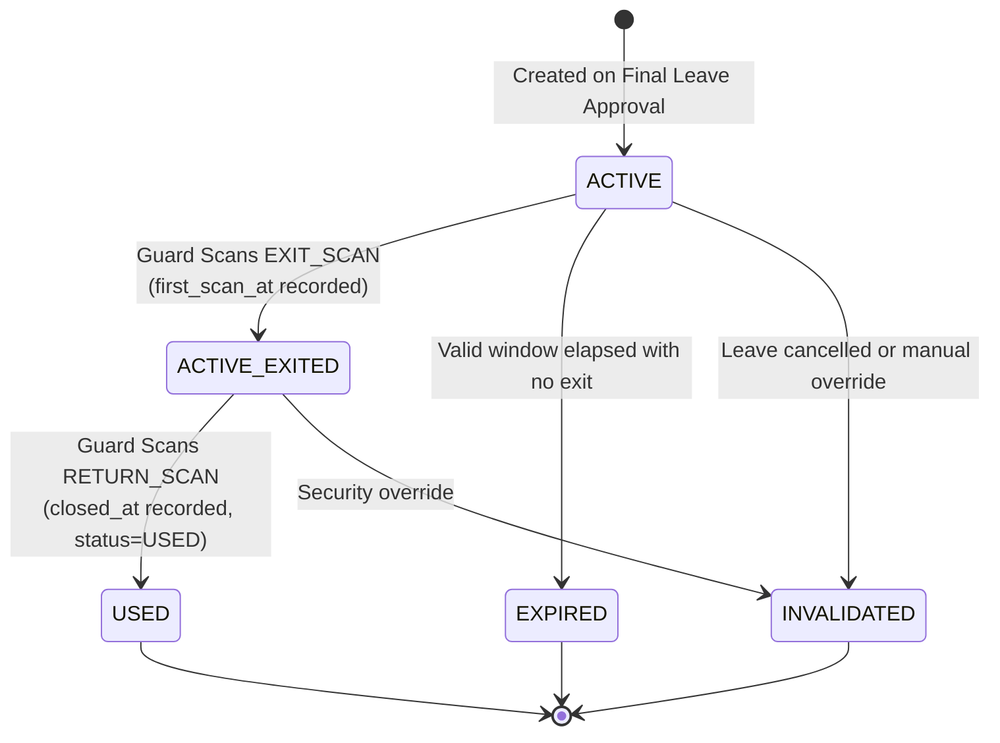

# 10 — QR & Movement Lifecycle

**Purpose:** Comprehensive guide to QR token cryptography, gate scanning concurrency protections, and physical student movement tracking.  
**Audience:** Security engineers, backend developers, gate operators, and QA engineers.  
**Status:** **IMPLEMENTED** (Verified from `src/services/movement/*` and `src/db/schema/movement.ts`)

---

## 1. Core Principle: Leave Approval Is NOT Movement

As defined in the system constitution (`AGENTS.md`):

```text
Leave: Permission (Digital intent)
Movement: Reality (Physical passage across gate)
```

* When a leave is `APPROVED`, the student does **not** move to `OUTSIDE_HOSTEL`.
* The student remains `IN_HOSTEL` (or nominal `APPROVED_LEAVE`) until their QR pass is physically presented and successfully scanned by a security guard at the campus gate.
* A student who never leaves experiences an automatic transition to `EXPIRED` (via cron T6).
* A student who leaves but does not return within the allotted window transitions to `OVERDUE` (via cron T7).

---

## 2. QR Token Cryptography & Storage

QR tokens must be securely stored while allowing the student app to display the scannable barcode and gate scanners to authenticate it in under 100 milliseconds.

```mermaid
flowchart TD
    subgraph ApprovalTime["Leave Approved (approveLeave)"]
        RawGen["Generate 32 Random Bytes (rawToken)"]
        HashToken["Compute SHA-256 (tokenHash)"]
        EncryptToken["Encrypt via AES-256-GCM (tokenEnc)"]
        StoreDB[("Insert into qr_passes:<br/>- token_hash (Indexed lookup key)<br/>- token_enc (Ciphertext envelope)<br/>(Plaintext rawToken is NEVER stored)")]
        RawGen --> HashToken & EncryptToken
        HashToken & EncryptToken --> StoreDB
    end

    subgraph DisplayTime["Student Opens App (get-qr-image)"]
        FetchEnc["Read tokenEnc from qr_passes"]
        Decrypt["Decrypt AES-256-GCM envelope"]
        Render["Render PNG QR barcode from rawToken"]
        FetchEnc --> Decrypt --> Render
    end

    subgraph GateScanTime["Guard Scans Pass (scanQrPass)"]
        CameraScan["Camera reads rawToken from screen"]
        HashInput["Compute SHA-256(rawToken)"]
        FastLookup["SELECT * FROM qr_passes WHERE token_hash = inputHash"]
        Validate["Validate valid_from <= now <= expires_at<br/>Record EXIT or RETURN"]
        CameraScan --> HashInput --> FastLookup --> Validate
    end
```



### 2.1 Encryption Envelope Format
Stored in `qr_passes.token_enc` using AES-256-GCM:
* Format: `v1:<keyId>:<iv>:<ciphertext>`
* Only decrypted in memory when generating the QR image stream (`get-qr-image.service.ts`).
* Gate scanning uses `token_hash` directly and **never decrypts** `token_enc`, maximizing throughput at the gates.

---

## 3. The Gate Scanning Lifecycle: Exit & Return

A single QR pass accommodates both exit and return movements.



### 3.1 Scan Type Auto-Detection (`detectScanType`)
Guards do not need to manually toggle between "Exit" and "Return" modes. The service auto-detects readiness:
1. `qrType === 'LEAVE_RETURN'` $\rightarrow$ Always `RETURN_SCAN`
2. `firstScanAt === null` $\rightarrow$ Ready for `EXIT_SCAN`
3. `firstScanAt !== null && closedAt === null` $\rightarrow$ Ready for `RETURN_SCAN`
4. `closedAt !== null` $\rightarrow$ Fully used (`null` returned; scan rejected)

---

## 4. Concurrency Protections at Gate Level

At peak exit hours (e.g., Friday 5:00 PM), thousands of scans occur across multiple gate terminals. The following multi-layered guards prevent duplicate exits and phantom sessions:

### 4.1 Window Gating (`validFrom <= now <= expiresAt`)
* Passes cannot be scanned before `validFrom` (leave start time).
* Passes cannot be scanned after `expiresAt` (`endAt` + grace period).

### 4.2 Single Active Session Check (`findOpenSessionPassForStudent`)
* A student who is already recorded as outside the hostel cannot execute a second `EXIT_SCAN` on another pass.

### 4.3 Atomic Guarded Updates (`markAsFirstScanned` / `markAsClosed`)
Within the database transaction:
```sql
UPDATE qr_passes
SET first_scan_at = now()
WHERE id = $1 AND first_scan_at IS NULL AND status = 'ACTIVE'
RETURNING id;
```
If two gate terminals scan the same barcode simultaneously, exactly one statement returns the row; the concurrent attempt receives `0 rows affected` and immediately throws `ConflictError("QR pass was concurrently scanned or invalidated")`.

---

## 5. Physical Movement Events Table (`movement_events`)

Every physical crossing creates an immutable audit row:
* `student_id`: Student in transit
* `leave_request_id`: Underlying leave authorization
* `qr_pass_id`: Physical pass presented
* `from_state` $\rightarrow$ `to_state`: e.g. `IN_HOSTEL` $\rightarrow$ `OUTSIDE_HOSTEL`
* `movement_method`: `'QR'` (or `'MANUAL'` for emergency gate guard override)
* `recorded_by`: Guard user UUID
* `occurred_at`: Precise gate timestamp
