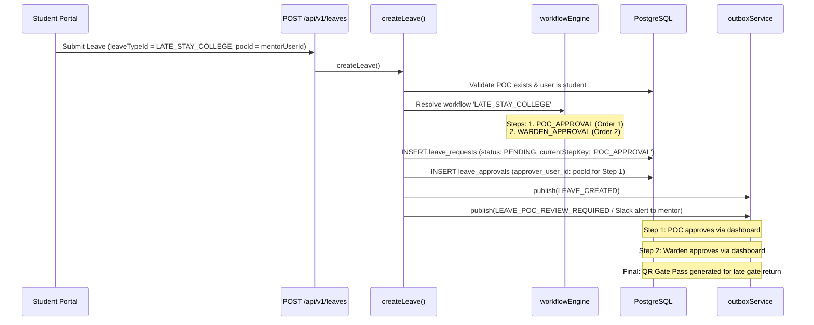
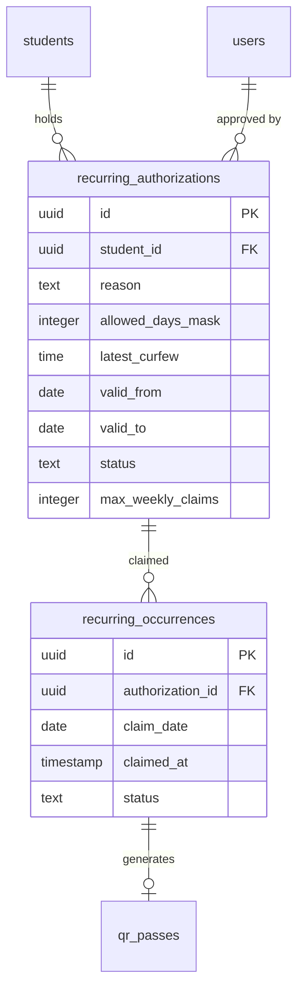

# 11 — Late-Stay & Recurring Authorization Analysis

**Purpose:** Comprehensive architectural investigation of the late-stay workflow, occurrence claiming, and assessment of recurring authorization features.  
**Audience:** System architects, product managers, and backend engineers.  
**Status:** **PARTIALLY IMPLEMENTED** (Verified from repository inspection)

---

## 1. Executive Implementation Summary

A critical distinction exists between generic recurring authorization requirements and the actual repository implementation:

* **What IS Implemented (`IMPLEMENTED`)**:
  * A dedicated leave type code **`LATE_STAY_COLLEGE`** seeded in `src/db/seed/leave-types.seed.ts`.
  * Dedicated workflow code **`LATE_STAY_COLLEGE`** requiring `POC_APPROVAL` prior to residential warden review.
  * Specialized student UI notices (`setShowPocNotice(isLateStay)` in `src/app/(dashboard)/student/leaves/new/page.tsx`).
  * Specialized Slack alerts sent to mentors (`leave_submitted_slack_late_stay_poc`).
  * Distinct rejection notification templates (`leave_rejected_email_late_stay_poc`, `leave_rejected_email_late_stay_admin`).
* **What is NOT Implemented (`NOT IMPLEMENTED`)**:
  * There is **no dedicated recurring authorization table** (e.g. no `recurring_late_stays` or `late_stay_authorizations`).
  * There is **no occurrence-claim subsystem** (e.g. claiming a pre-approved slot for tonight without creating a leave).
  * There is **no authorization version supersession** or balance-tracking mechanism.

### Architectural Reality
In the existing codebase, **every late stay is treated as an individual, discrete `leave_requests` record** parameterized with `leave_type.code = 'LATE_STAY_COLLEGE'`.

---

## 2. Implemented `LATE_STAY_COLLEGE` Workflow Trace

When a student needs to work late in a college lab, library, or project room:

---

## 3. Comparison: Implemented Discrete Flow vs. Proposed Recurring Claim Flow

| Capability | Current Codebase (`LATE_STAY_COLLEGE`) | Proposed Recurring Claim Model |
| :--- | :--- | :--- |
| **Submission Model** | One leave request per late-stay event. | Semester-long standing permission approved once by Dean/HOD. |
| **Claiming Mechanism** | Full leave form submission with reason and dates. | One-click daily occurrence check-in via mobile app. |
| **Approval Overhead** | POC and Warden must approve each late stay individually. | Pre-approved; student claims daily token up to weekly quota. |
| **Database Entity** | `leave_requests` table with status `PENDING`. | Dedicated `recurring_authorizations` and `occurrence_claims` tables. |
| **Gate Enforcement** | Scannable QR generated per approved request. | Daily dynamic QR linked to standing authorization. |

---

## 4. Recommended Architectural Blueprint for Full Recurring System

If SST requires semester-long recurring late stays (e.g. for robotics lab teams or competition prep), the following architecture should be implemented to avoid polluting `leave_requests`:

### Invariants for Future Implementation
1. **Uniqueness**: Unique constraint on `(authorization_id, claim_date)` to ensure idempotency.
2. **Quota Checks**: Atomic check of claims within the calendar week against `max_weekly_claims`.
3. **Leave Conflict Guard**: Claiming an occurrence must be mutually exclusive with an active overnight leave.
