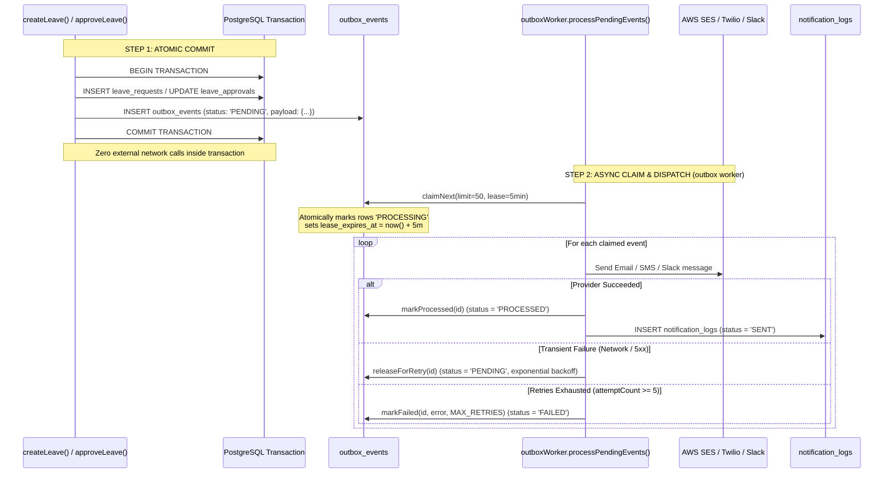

# 12 — Notification System & Transactional Outbox

**Purpose:** Comprehensive architectural documentation of the transactional outbox pattern, worker polling loop, retry backoff, and multi-channel provider dispatch.  
**Audience:** Backend engineers, infrastructure operators, and messaging architects.  
**Status:** **IMPLEMENTED** (Verified from `src/services/outbox/*` and `src/services/notification/*`)

---

## 1. The Distributed Notification Problem

In residential management, state transitions must trigger notifications (e.g., student submits leave $\rightarrow$ parent receives approval link; leave approved $\rightarrow$ QR pass emailed).

### Why Direct In-Service Delivery Fails
If a domain service calls AWS SES or Twilio directly inside the HTTP request:
1. **Dual-Write Vulnerability**: If the DB commits but SES times out, the user sees an error, retries, and creates a duplicate leave. If SES succeeds but the DB rolls back, the parent approves a leave that doesn't exist.
2. **Latency Penalty**: Network latency to external email/SMS providers (500ms–2s) directly inflates client HTTP response times.
3. **Provider Outages**: If Twilio is down, leaves cannot be approved.

### The Solution: Transactional Outbox Pattern
The SST Hostel Leave system implements a database-backed **Transactional Outbox Pattern**:



---

## 2. Outbox Schema & Concurrency Design

### 2.1 The `outbox_events` Table (`src/db/schema/outbox.ts`)
* **`id`**: UUID primary key.
* **`event_type`**: Semantic event string (`LEAVE_CREATED`, `LEAVE_APPROVED`, `PARENT_APPROVAL_REQUIRED`, `QR_GENERATED`).
* **`aggregate_type`**: Entity type (`LEAVE_REQUEST`, `QR_PASS`, `NOTIFICATION`).
* **`aggregate_id`**: Foreign entity UUID.
* **`payload`**: JSONB holding structured event data.
* **`idempotency_key`**: TEXT, UNIQUE (`${eventType}:${aggregateType}:${aggregateId}:${optionalSuffix}`).
* **`status`**: ENUM (`PENDING`, `PROCESSING`, `PROCESSED`, `FAILED`, `DEAD_LETTER`).
* **`attempt_count`**: Integer attempt counter.
* **`lease_expires_at`**: Timestamp preventing worker crashes from stranding events in `PROCESSING`.
* **`next_attempt_at`**: Timestamp enabling exponential backoff without scanning all rows.

### 2.2 Atomic Lease Claiming (`claimNext`)
To prevent concurrent serverless instances (e.g. parallel Vercel instances) from double-processing the same notifications, `outboxRepository.claimNext()` executes an atomic update query:
```sql
UPDATE outbox_events
SET status = 'PROCESSING',
    claimed_at = now(),
    lease_expires_at = now() + interval '5 minutes',
    attempt_count = attempt_count + 1
WHERE id IN (
    SELECT id FROM outbox_events
    WHERE status = 'PENDING'
      AND (next_attempt_at IS NULL OR next_attempt_at <= now())
    ORDER BY created_at ASC
    LIMIT 50
    FOR UPDATE SKIP LOCKED
)
RETURNING *;
```
* **`SKIP LOCKED`**: Ensures parallel workers instantly skip rows claimed by other workers without blocking or deadlocking.

---

## 3. Worker Handlers & Dispatch Routing

The worker (`src/services/outbox/outbox-worker.service.ts`) dispatches events to three specialized handlers based on event prefix:

1. **`handleLeaveEvent`** (`src/services/outbox/handlers/leave-event.handler.ts`):
   * Handles: `LEAVE_CREATED`, `LEAVE_APPROVED`, `LEAVE_REJECTED`, `LEAVE_CANCELLED`, `PARENT_APPROVAL_REQUIRED`.
   * For `PARENT_APPROVAL_REQUIRED`: Invokes `generateParentApproval()` to mint high-entropy magic link and trigger SMS dispatch.
2. **`handleMovementEvent`** (`src/services/outbox/handlers/movement-event.handler.ts`):
   * Handles: `QR_GENERATED`, `QR_SCANNED`, `QR_INVALIDATED`, `MOVEMENT_*`.
   * Generates QR attachments and delivers exit confirmations.
3. **`handleNotificationEvent`** (`src/services/outbox/handlers/notification-event.handler.ts`):
   * Handles: `NOTIFICATION_REQUESTED`.
   * Queries `notification_rules` and `notification_templates`, interpolates variables, and dispatches via provider channels.

---

## 4. Multi-Channel Providers

* **Email Provider (`email.provider.ts`)**:
  * AWS SES (`@aws-sdk/client-ses`) or Resend fallback.
  * Formats HTML templates with college letterhead and dynamic QR image attachments.
* **SMS Provider (`sms.provider.ts`)**:
  * Native HTTP SMS API.
  * Enforces DLT (Distributed Ledger Technology) compliant template formats for Indian telecom regulations (`buildParentApprovalDltName`).
* **Slack Provider (`slack.provider.ts`)**:
  * Posts automated notifications directly into hostel staff and POC channels (`@slack/web-api`).
* **In-App Provider (`in-app.provider.ts`)**:
  * Inserts persistent web notification bell records for students and staff.

---

## 5. Delivery Guarantees & Edge Cases

| Dimension | Guarantee | Repository Mechanism |
| :--- | :--- | :--- |
| **Database $\rightarrow$ Outbox** | Exactly-Once | Atomic commit inside same PostgreSQL transaction. |
| **Outbox Claiming** | Exactly-Once per Lease | `FOR UPDATE SKIP LOCKED` with 5-minute lease expiry. |
| **Outbox $\rightarrow$ Provider** | At-Least-Once | Retried up to 5 times. If provider accepts but times out, retry may send duplicate. |
| **Worker Crash Recovery** | Automatic | `lease_expires_at` elapses $\rightarrow$ reclaimed on next drain pass. |
| **Poison Pill Handling** | Isolated Failure | Unknown event types immediately consume retry budget to prevent infinite loops. |
