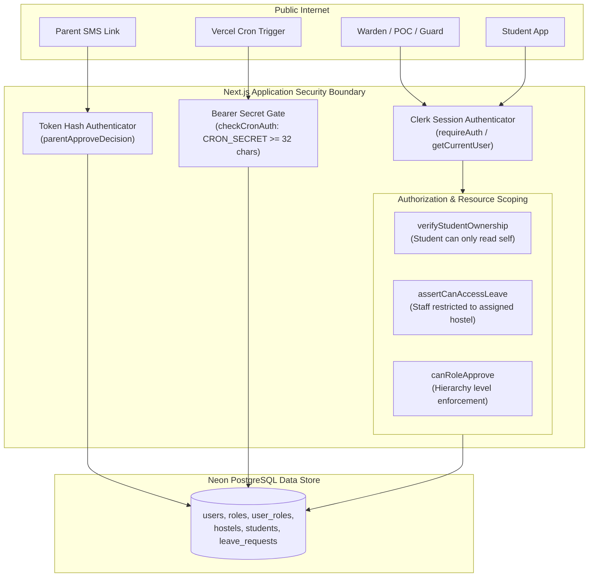

# 13 — Authentication & Resource-Scoped Authorization

**Purpose:** Comprehensive guide to authentication architecture, Clerk identity linking, 5-role hierarchy, and hostel-scoped access control.  
**Audience:** Security engineers, backend developers, and compliance reviewers.  
**Status:** **IMPLEMENTED** (Verified from `src/lib/auth/*` and `src/services/shared/authorization.service.ts`)

---

## 1. Authentication Architecture & Trust Boundaries

The system supports two distinct authentication realms:
1. **Internal Campus Users (Staff, Students, Guards)**: Authenticated via Clerk Identity Provider (`@clerk/nextjs`).
2. **External Parents**: Authenticated via single-use, high-entropy cryptographic tokenized URLs (no login, no Clerk).



---

## 2. Clerk Account Synchronization & OWASP Mitigations

The identity resolution pipeline (`src/lib/auth/get-current-user.ts`) executes on every authenticated request:

1. **Clerk ID Lookup**: Fast lookup in `users` table by `clerk_id`.
2. **Verified Email Account Claiming**:
   * If no user matches `clerk_id`, lookup user by `clerkUser.emailAddresses[0]`.
   * **Crucial Security Check**: Only link the database account if `emailVerification.status === 'verified'` in Clerk.
   * *Defense*: Prevents OWASP A07 Account Takeover. An attacker registering with an unverified victim email cannot inherit pre-provisioned warden or admin privileges.
3. **Auto-Provisioning**: If no user exists, creates a baseline user record with zero assigned roles.
4. **Login Signal Tracking**: Calls `userRepository.touchLastLogin(dbUser.id)` in a non-blocking `try/catch` to record login activity.

---

## 3. The 5-Role Model & Operational Hierarchy

Defined in `src/lib/auth/roles.ts`:

```ts
export const ROLES = {
  GUARD: "GUARD",
  STUDENT: "STUDENT",
  POC: "POC",
  ADMIN: "ADMIN",
  SUPER_ADMIN: "SUPER_ADMIN",
} as const;

export const ROLE_HIERARCHY: Record<Role, number> = {
  GUARD: 0,
  STUDENT: 0,
  POC: 1,
  ADMIN: 2,
  SUPER_ADMIN: 3,
};
```

### Hierarchical Approval Rule (`canRoleApprove`)
A user possessing a role at or above the step's required hierarchy level can approve the step:
* An `ADMIN` (Level 2) can approve a `POC` step (Level 1).
* A `SUPER_ADMIN` (Level 3) can approve any step.
* A `GUARD` (Level 0) can only scan gate passes and cannot approve leaves.

---

## 4. Multi-Tenant Resource Scoping (Hostel Scoping)

In a university with multiple hostels (e.g. Boys Hostel 1, Girls Hostel 2), wardens must be restricted to their assigned hostel.

### Scoping Schema (`user_roles`)
* `scope_type`: e.g. `'HOSTEL'`
* `scope_id`: UUID of assigned hostel
* Unique Constraint: `(user_id, role_id, scope_type, scope_id)` allows a single warden to oversee multiple specific hostels.

### Enforcement Rules (`src/services/shared/authorization.service.ts`)
1. **Unrestricted Access**: `SUPER_ADMIN` or staff with `scope_type === null` hold unrestricted global campus access.
2. **Most-Restrictive-Wins (`isStaffScopeRestricted`)**: If any staff role held by a user is scoped, scoping is enforced for that user.
3. **Leave Access Guard (`assertCanAccessLeave`)**:
   * For students: Calls `verifyStudentOwnership()`; students can only access their own records.
   * For staff: Retrieves the student's assigned hostel (`student.user.hostelId`) and verifies it is in `getScopedHostelIds(currentUser)`. If not, throws `403 AuthorizationError("You do not have access to this leave")`.

---

## 5. Role & Permission Matrix

| Capability | STUDENT | GUARD | POC | ADMIN | SUPER_ADMIN | PARENT |
| :--- | :---: | :---: | :---: | :---: | :---: | :---: |
| **Submit Leave Request** | Yes | No | No | No | No | No |
| **Cancel Own Leave** | Yes | No | No | No | No | No |
| **Upload Proof Documents** | Yes | No | No | Yes | Yes | No |
| **Approve POC Stage** | No | No | Yes | Yes (Hierarchy) | Yes | No |
| **Approve Warden Stage** | No | No | No | Yes (Scoped) | Yes | No |
| **Parent Link Approval** | No | No | No | No (Override only)| No (Override only)| Yes (Token) |
| **Parent Step Override** | No | No | No | Yes (Explicit confirm) | Yes | No |
| **Scan QR Pass at Gate** | No | Yes | No | Yes | Yes | No |
| **Manual Gate Override** | No | Yes | No | Yes | Yes | No |
| **Manage Policies & Leave Types**| No | No | No | No | Yes | No |
| **Trigger Outbox Drain** | No | No | No | Yes | Yes | No |
| **Access Audit Logs** | No | No | No | Scoped | Global | No |
