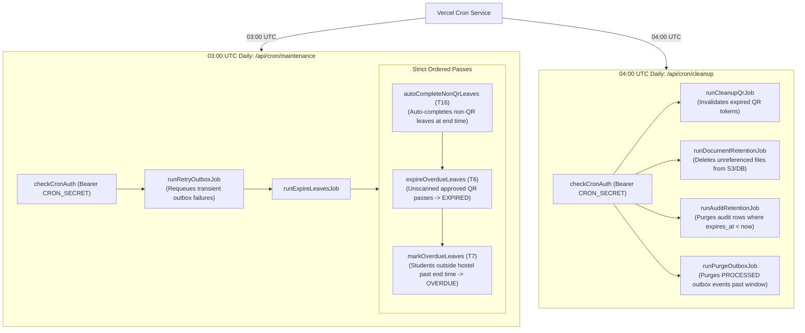

# 14 — Background Jobs & Scheduled Cron Tasks

**Purpose:** Comprehensive architectural specification of scheduled cron jobs, maintenance workers, retention sweeps, and bearer security gates.  
**Audience:** Site reliability engineers, DevOps, and backend developers.  
**Status:** **IMPLEMENTED** (Verified from `src/services/cron/*` and `vercel.json`)

---

## 1. Cron Topology & Scheduling

The system relies on scheduled maintenance passes configured in `vercel.json`:

```json
{
  "crons": [
    {
      "path": "/api/cron/cleanup",
      "schedule": "0 4 * * *"
    },
    {
      "path": "/api/cron/maintenance",
      "schedule": "0 3 * * *"
    }
  ]
}
```



---

## 2. Authentication Gate: `checkCronAuth`

All routes under `/api/cron/*` are guarded by `src/lib/auth/cron-auth.ts`:

* **Invariant**: Must supply `Authorization: Bearer <CRON_SECRET>` header.
* **Length Requirement**: `CRON_SECRET` must be $\ge 32$ characters.
* **Fail-Closed Policy**: If `CRON_SECRET` is unset, null, or shorter than 32 characters, the gate unconditionally returns `401 Unauthorized`.
* **Zero Fingerprinting**: Missing headers or invalid tokens return an identical 401 payload, preventing attackers from probing whether the secret is configured.

---

## 3. Maintenance Pass Breakdown (`03:00 UTC`)

Route: `src/app/api/cron/maintenance/route.ts`

### 3.1 `runRetryOutboxJob`
* Queries `outbox_events` with `status = 'FAILED'` and `attempt_count < 5`.
* Resets status to `PENDING` and clears `last_error` so the outbox worker can re-attempt delivery.

### 3.2 `runExpireLeavesJob` (The Strict Sequence)
Governed by `src/services/cron/expire-leaves.job.ts`:

```ts
export async function runExpireLeavesJob(): Promise<ExpireLeavesJobResult> {
  // Order matters: T16 completes non-QR leaves first so the expiry pass (T6)
  // only ever sees QR leaves.
  const completed = await autoCompleteNonQrLeaves(SYSTEM_USER);
  const expired = await expireOverdueLeaves(SYSTEM_USER);
  const overdue = await markOverdueLeaves(SYSTEM_USER);
  return { job: "expire-leaves", completed, expired, overdue };
}
```

1. **`autoCompleteNonQrLeaves` (Rule T16)**:
   * Finds leaves where `status = 'APPROVED'`, `end_at <= now()`, and `qr_mode === 'NONE'`.
   * These leaves do not require gate scanning; they transition to `COMPLETED` automatically.
2. **`expireOverdueLeaves` (Rule T6)**:
   * Finds leaves where `status = 'APPROVED'`, `end_at <= now()`, but no `EXIT_SCAN` was ever recorded.
   * Student stayed in hostel and never utilized the pass $\rightarrow$ transitions to `EXPIRED`.
3. **`markOverdueLeaves` (Rule T7)**:
   * Finds leaves where student exited (`from_state = 'OUTSIDE_HOSTEL'`), but `end_at + curfew_grace <= now()` and no `RETURN_SCAN` exists.
   * Atomically transitions leave status to `OVERDUE` and student movement state to `OVERDUE`.
   * Triggers `LEAVE_OVERDUE` outbox notifications to parents and hostel wardens.

---

## 4. Cleanup Pass Breakdown (`04:00 UTC`)

Route: `src/app/api/cron/cleanup/route.ts`

### 4.1 Per-Job Isolation
The cleanup route runs four retention jobs in an isolated loop:
```ts
const jobs: Array<[string, () => Promise<unknown>]> = [
  ["cleanup-qr", runCleanupQrJob],
  ["document-retention", runDocumentRetentionJob],
  ["audit-retention", runAuditRetentionJob],
  ["purge-outbox", runPurgeOutboxJob],
];
```
* **Fault Tolerance**: If `document-retention` throws (e.g., S3 outage), the error is logged and collected; the runner continues and executes `audit-retention` and `purge-outbox`.
* **Outbox Payload Purging (`purge-outbox`)**:
  * Outbox payloads for parent approval contain raw URLs. Once processed and past the retention window (e.g. 14 days), `runPurgeOutboxJob` purges the rows to prevent historical token retention.
* **Audit Retention (`audit-retention`)**:
  * Deletes rows in `audit_logs` where `expires_at < now()`.
  * Preserves `CONFIG_MUTATION` records permanently (`expires_at === null`).

---

## 5. System Actor Representation (`systemActor`)

Since cron jobs execute without a logged-in user, audit logs cannot reference a real `actor_user_id` foreign key.
* The system invokes `systemActor("expire-leaves")` (`src/constants/audit/actor.ts`).
* Stores `actorUserId: null` in the foreign key column.
* Attaches `{ actorType: "SYSTEM", job: "expire-leaves" }` inside the `metadata` JSONB column, preserving a transparent audit trail.
