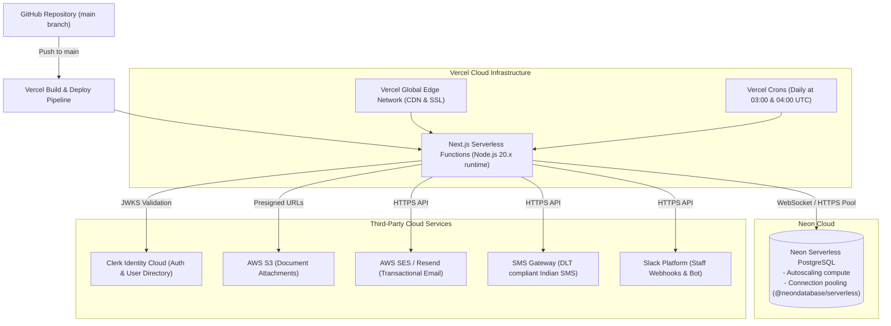

# 15 — Deployment & Infrastructure Architecture

**Purpose:** Comprehensive topology of cloud hosting, database connectivity, external SaaS dependencies, and environment variable specifications.  
**Audience:** DevOps engineers, cloud architects, and system administrators.  
**Status:** **IMPLEMENTED** (Verified from `package.json`, `vercel.json`, and source code)

---

## 1. Hosting & Runtime Topology

The SST Hostel Leave system is deployed on the **Vercel Cloud Platform**, taking advantage of Next.js 16 App Router serverless executions and edge caching.



---

## 2. CI/CD & Deployment Lifecycle

Configured in `vercel.json`:
```json
{
  "ignoreCommand": "if [ \"$VERCEL_GIT_COMMIT_REF\" != \"main\" ]; then exit 0; else exit 1; fi"
}
```

### Deployment Rule
* **Main Branch Only**: Builds and deployments are triggered exclusively when pull requests merge into `main`. Feature branch pushes are ignored to conserve serverless build minutes and protect production credentials.
* **Pre-Deployment Audits**:
  * `npm run typecheck` (`tsc --noEmit`) validates TypeScript strict types.
  * `npm run lint` enforces ESLint boundary and architectural rules.
  * `npm run test` executes the complete Vitest test suite.

---

## 3. Database Connectivity: Neon Serverless

* **Client**: `@neondatabase/serverless` (v1.1.0) with Drizzle ORM (v0.45.2).
* **Connection Protocol**: Communicates via WebSockets / HTTP tunnel, allowing serverless functions to scale from 0 to 1,000 instances without exhausting PostgreSQL connection limits.
* **Connection String**: Provided via `DATABASE_URL` (pooled connection string for runtime queries, direct connection string for migrations).

---

## 4. Environment Variables Specification

The system requires the following environment variables (grouped by responsibility; no secret values are documented):

### 4.1 Database & Persistence
* `DATABASE_URL`: Connection URI for Neon PostgreSQL database.
* `DATABASE_URL_UNPOOLED`: Direct connection string used during `drizzle-kit migrate` schema migrations.

### 4.2 Authentication & Identity
* `NEXT_PUBLIC_CLERK_PUBLISHABLE_KEY`: Public Clerk frontend API key.
* `CLERK_SECRET_KEY`: Backend Clerk secret key for session verification.
* `CRON_SECRET`: High-entropy string ($\ge 32$ characters) guarding `/api/cron/*`.

### 4.3 Storage & AWS Integrations
* `AWS_ACCESS_KEY_ID`: IAM user access key.
* `AWS_SECRET_ACCESS_KEY`: IAM user secret key.
* `AWS_REGION`: AWS region (e.g., `ap-south-1`).
* `AWS_S3_BUCKET_NAME`: Bucket name for medical/academic leave attachments.
* `AWS_SES_FROM_EMAIL`: Verified sender email address.

### 4.4 Alternative Email & Messaging
* `RESEND_API_KEY`: API key for Resend transactional email fallback.
* `SMS_API_KEY` / `SMS_SENDER_ID`: Credentials for SMS gateway provider.
* `SLACK_BOT_TOKEN` / `SLACK_SIGNING_SECRET`: Credentials for Slack channel notifications.
* `NEXT_PUBLIC_BASE_URL`: Public canonical base URL (e.g. `https://hostel.sst.edu.in`) used to construct parent magic links.

---

## 5. Observability & Monitoring

* **Vercel Analytics & Speed Insights**: Integrated via `@vercel/analytics` and `@vercel/speed-insights`.
* **Structured Logger**: `src/lib/logger.ts` outputs JSON-structured logs containing correlation IDs and error traces for log aggregators (e.g. Datadog, CloudWatch).
