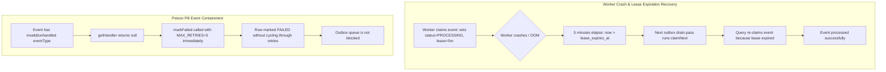

# 17 — Failure Modes & Recovery Matrix

**Purpose:** Comprehensive matrix of failure scenarios, network partitions, concurrency collisions, recovery protocols, and consistency guarantees.  
**Audience:** Site reliability engineers, incident response teams, and backend architects.  
**Status:** **IMPLEMENTED** (Verified from codebase inspection and transactional tests)

---

## 1. Concurrency & Failure Scenarios Matrix

| Failure Scenario | Immediate System Behavior | Data Consistency Impact | Retry Safety | Detection & Observability | Recovery Protocol |
| :--- | :--- | :--- | :--- | :--- | :--- |
| **Two simultaneous leave submissions by same student** | First acquires `student FOR UPDATE` lock; second blocked. Second fails `assertNoConflictingOverlap`. | Zero corruption. Only first leave is created. | Safe to retry with non-overlapping dates. | Second request receives `409 ConflictError`. | User is prompted that overlapping leave exists. |
| **Two approvers act on same step simultaneously** | First acquires `leave_requests FOR UPDATE`. Second blocked until first commits. Second finds status non-pending. | Zero corruption. Exactly one approval is recorded. | Safe; duplicate rejected. | `409 ConflictError("Leave is not in a state that can be approved")`. | Second approver UI updates to show current status. |
| **Two guards scan same QR code simultaneously** | Both hit `scanQrPass()`. Atomic `UPDATE ... WHERE first_scan_at IS NULL` returns 1 row for winner, 0 for loser. | Zero corruption. Exactly one exit movement is recorded. | Safe; duplicate scan fails. | Loser receives `409 ConflictError("QR pass was concurrently scanned")`. | Second guard terminal alerts "Pass already scanned". |
| **Outbox worker crashes during email/SMS dispatch** | Event was marked `PROCESSING` with `lease_expires_at = now() + 5m`. Event remains in DB. | At-least-once preserved. No data loss. | Fully idempotent retry. | Next worker run sees expired lease and re-claims row. | Automatic recovery via lease expiration timeout. |
| **External Email / SMS Provider outage (SES/Twilio 5xx)** | Provider call throws. Worker increments `attempt_count`, sets `next_attempt_at` with exponential backoff. | Zero business state loss. Notification stays in outbox. | Automatic background retry up to 5 attempts. | Logs error with error stack in `outbox_events.last_error`. | Worker retries automatically. If 5 attempts fail, marked `FAILED`. |
| **Provider succeeds but worker crashes before marking processed** | Email was sent. Worker did not execute `markProcessed()`. Row re-claimed after lease expiry. | At-least-once side effect: Recipient receives duplicate email. | Safe (duplicate delivery). | Duplicate notification recorded in `notification_logs`. | Harmless operational redundancy; recipient gets duplicate alert. |
| **Vercel Cron fires twice simultaneously** | Both hit cron route. Row locks in `expireOverdueLeaves` prevent double transitions. | Zero corruption. State transitions are idempotent. | Safe. | Log indicates 0 rows updated on second invocation. | Idempotent queries process 0 additional records. |
| **Database transaction rolls back halfway through leave creation** | Exception thrown during policy or approval step insertion. Transaction aborts. | Exactly zero rows persisted in `leave_requests`, `leave_approvals`, or `outbox_events`. | Clean retry. | `500` or `4xx` returned to client. | Caller retries submission; DB remains in pristine state. |
| **Student presents expired QR pass at gate** | `scanQrPass()` detects `now() > pass.expiresAt`. Updates status to `INVALIDATED`. | Invariant preserved. No exit allowed. | Not retriable. | Creates failed scan record in `qr_scan_logs`. | Gate remains locked; student referred to warden. |
| **Student attempts return scan without exit scan** | `scanQrPass()` detects `first_scan_at === null` and `qrType !== 'LEAVE_RETURN'`. | Invariant preserved. | Not retriable. | Fails with `"Student has not exited yet"`. | Gate guard initiates manual investigation or security override. |

---

## 2. Distributed Recovery Workflows

---

## 3. Database vs. Application Guarantees

| Invariant | Database Enforced | Application Enforced |
| :--- | :---: | :---: |
| **Target constraint for leave approvals** | **YES** (`num_nonnulls(leaveRequestId, leaveExtensionId) = 1`) | YES (Service asserts target) |
| **One QR pass per leave per type** | **YES** (`UNIQUE(leave_request_id, qr_type)`) | YES (Service checks existence) |
| **Student single active exit session** | NO | **YES** (`findOpenSessionPassForStudent`) |
| **Leave date non-overlap** | NO (Application date range query) | **YES** (`assertNoConflictingOverlap`) |
| **Unique parent phone per student** | **YES** (`UNIQUE(student_id, phone)`) | YES (Service validation) |
| **Sequential extension numbers** | **YES** (`UNIQUE(leave_request_id, extension_number)`) | YES (Calculated as `count + 1`) |
