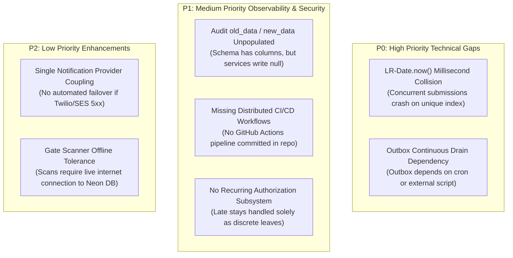

# 23 — Engineering Gaps, Unverified Behaviors & Production Roadmap

**Purpose:** Transparent, unvarnished catalog of technical gaps, unverified implementations, missing safeguards, and prioritized engineering recommendations.  
**Audience:** Technical leads, engineering directors, and software architects.  
**Status:** **IMPLEMENTED** (Direct findings from codebase inspection)

---

## 1. Summary of Architectural Gaps Discovered

Following an exhaustive code inspection, the following technical gaps and incomplete features were confirmed:



---

## 2. In-Depth Gap Analysis

### 2.1 P0: Millisecond Request Number Collisions
* **Location**: `src/services/leave/create-leave.service.ts`:
  ```ts
  const requestNumber = `LR-${Date.now()}`;
  ```
* **Vulnerability**: `Date.now()` resolves to millisecond resolution. If two students submit a leave in the exact same millisecond across the university, the second request crashes with a PostgreSQL unique constraint violation:
  `duplicate key value violates unique constraint "leave_requests_request_number_key"`.
* **Fix**: Use a native PostgreSQL sequence, ULID, or append cryptographically secure random entropy:
  ```ts
  const requestNumber = `LR-${Date.now()}-${crypto.randomUUID().slice(0, 4).toUpperCase()}`;
  ```

### 2.2 P0: Outbox Worker Drain Dependency
* **Location**: `src/services/outbox/outbox-worker.service.ts`
* **Vulnerability**: While the outbox table and atomic lease mechanism are implemented, Vercel cron runs only twice a day (at 03:00 and 04:00 UTC). Notifications queued during daytime hours require an external scheduler or HTTP client calling `POST /api/v1/outbox/process` or running `npm run outbox:drain`.
* **Fix**: Configure a high-frequency cron (e.g. every 1 minute via GitHub Actions, Vercel cron, or QStash / Inngest) to continuously drain the outbox queue.

### 2.3 P1: Audit Log Snapshot Gaps
* **Location**: `src/db/schema/audit.ts`
* **Observation**: The schema defines `old_data` (JSONB) and `new_data` (JSONB). However, the schema comments explicitly confirm:
  > *"Reserved columns (oldData/newData snapshots, ipAddress/userAgent) are intentionally unwritten today: auditService.record persists action + entity + actor + metadata only."*
* **Impact**: Forensic state diffs cannot be reconstructed purely from `audit_logs`; historical changes must be inferred from versioning tables (`leave_type_versions`, `workflow_versions`).
* **Fix**: Plumb entity serialization into `auditService.record()` so before-and-after snapshots are captured on updates.

### 2.4 P1: Incomplete Recurring Late-Stay Subsystem
* **Location**: `src/db/schema/leave.ts`, `src/services/leave/*`
* **Observation**: The codebase seeds and processes `LATE_STAY_COLLEGE` leaves through the standard leave pipeline with mentor approval. However, there are no standing authorization models or daily occurrence-claim tables. Students must submit an individual leave form for every single late stay.
* **Fix**: Implement the `recurring_authorizations` and `recurring_occurrences` domain schema documented in [11-recurring-late-stay.md](file:///c:/Users/Veda/Desktop/SST-Hostel-Leave/docs/architecture/11-recurring-late-stay.md).

### 2.5 P2: Gate Scanner Offline Tolerance
* **Location**: `src/services/movement/scan-qr.service.ts`
* **Observation**: Gate scanning performs a live database query against Neon PostgreSQL. If the campus experiences a local internet fiber cut, guards cannot scan passes.
* **Fix**: Deploy a local Edge cache (e.g. local Redis or SQLite replica on the guard's tablet) that caches active daily QR hashes, syncing movements back to PostgreSQL upon network reconnection.

---

## 3. Prioritized Engineering Roadmap

| Priority | Task Description | Target File / Module | Estimated Effort |
| :---: | :--- | :--- | :---: |
| **P0** | Replace `LR-${Date.now()}` with collision-proof sequence or ULID. | `src/services/leave/create-leave.service.ts` | 1 hour |
| **P0** | Deploy an automated 1-minute outbox drain cron (via Inngest, QStash, or GitHub Actions). | `vercel.json` / Workflow | 2 hours |
| **P1** | Implement `oldData` and `newData` snapshot capture in `auditService.record`. | `src/services/audit/audit.service.ts` | 4 hours |
| **P1** | Implement automated GitHub Actions CI pipeline for lint, typecheck, and Vitest. | `.github/workflows/ci.yml` | 2 hours |
| **P2** | Implement recurring standing authorization and occurrence-claim tables. | `src/db/schema/recurring.ts` | 3 days |
| **P2** | Introduce offline PWA pass caching for gate guard tablets. | `src/app/(dashboard)/guard/` | 1 week |
